Machine learning, clinical AI validation and the data systems behind the centre’s studies, from models on clinical and sensor data to the platforms that collect it in the field.

## Current work

```{=html}
<ul class="plain-list gwork"><li><strong>PRAKASH tracking system</strong> – A digital test, treat and track system that follows each person from the first haemoglobin test to a confirmed result, used at the Koppal site of the ICMR anaemia study.</li><li><strong>Hospital management software</strong> – A bed management system and an operation theatre management system running across St. John's Medical College Hospital, with live dashboards and regular performance reports.</li><li><strong>Clinical AI validation</strong> – Prospective validation of AI diagnostic tools against reference standards, with attention to uncertainty and failure cases. Includes LIRA, an AI tool for TB screening.</li><li><strong>Wearable activity classification</strong> – Models that classify carried, sedentary, light and moderate-to-vigorous activity in toddlers from raw accelerometer data.</li><li><strong>Gait and movement analysis</strong> – Marker-less, computer-vision gait analysis built in-house, with validation of OpenCap for detecting artificial biomechanical conditions.</li><li><strong>Digital twins for device trials</strong> – Mathematical models of medical devices, used to plan and stress-test clinical trials before participants are enrolled.</li><li><strong>Evidence synthesis</strong> – Systematic review and meta-analysis of salt, rice and wheat fortification and anaemia, iron deficiency and other micronutrient deficiencies (PROSPERO CRD420261306419).</li></ul>
```

## PRAKASH tracking

PRAKASH is the test, treat and track system for the ICMR anaemia implementation study. It was built by this group for the Koppal site, and it is designed to follow a **person**, not a count of tablets.

### The problem it addresses

India has given out iron and folic acid for more than four decades, yet anaemia prevalence has barely moved. The national monitoring system counts what is distributed, not what happens to each beneficiary.

- **Tablets counted, not taken.** Reporting shows how many tablets went out. It cannot show whether a particular woman or child took them.
- **No reminder to retest.** Nothing prompts the ASHA for a repeat haemoglobin test, so cases drift with no conclusion.
- **Paper resolution.** A case can be closed when the course of pills ends, without a retest to show the anaemia has gone.
- **Blind supervision.** Medical officers see block percentages, not which workers need support.

```{=html}
<div class="dv-facts" style="grid-template-columns:repeat(auto-fit,minmax(150px,1fr))">
<div><b>~4,000</b><span>Participants enrolled</span><em>Research scale, Koppal</em></div>
<div><b>5</b><span>Sampled areas</span><em>Across the district</em></div>
<div><b>~60</b><span>ASHA workers connected</span><em>Each with a personal list</em></div>
</div>
```

### How it works

Field staff and ASHAs enter data on ordinary smartphones through a browser form, so nothing needs installing. Entries go to a live database, a rules engine classifies each result against WHO haemoglobin cut-offs and advances the person through the cascade, and role-specific dashboards show the same data to each level of the health system.

```{=html}
<div class="flow4">
<div><span>01</span><h4>Field</h4><p>ASHAs and ANMs enrol people and enter haemoglobin results through a browser form. No app to install.</p></div>
<div><span>02</span><h4>Data</h4><p>A live database applies WHO classification and gives each person a cascade state.</p></div>
<div><span>03</span><h4>Analytics</h4><p>A Python engine times the alerts, flags non-responders and scores PHC and ASHA performance.</p></div>
<div><span>04</span><h4>Display</h4><p>Browser dashboards for medical officers, ASHAs and the research team, plus exportable reports.</p></div>
</div>
```

### The cascade

Every person has a state that moves forward with time and with results. The alerts are set against the national protocol, so the 30 and 90 day checkpoints shown are the defaults for one common case, not a fixed rule.

```{=html}
<div class="cascade">
<div class="cs"><b>Pending</b><span>Anaemia found</span></div><i></i>
<div class="cs"><b>Treatment started</b><span>Logged by the ASHA</span></div><i></i>
<div class="cs"><b>Compliance check due</b><span>Day 30, home visit alert</span></div><i></i>
<div class="cs"><b>Hb retest due</b><span>Day 90, turns red if late</span></div><i></i>
<div class="cs ok"><b>Resolved</b><span>Only after a retest shows a rise of at least 1 g/dL</span></div>
</div>
<p class="cascade-note">A person whose retest does not improve is flagged as a non-responder and sent down a differential-diagnosis path (blood count, serum ferritin, CRP), because not all anaemia is iron deficiency.</p>
```

The key design rule is that a case cannot be closed without a retest value. Closing on paper is not possible.

### What each person sees

- **Chief medical officer** – District prevalence, PHC ranking, severe-anaemia escalations and the monthly trend against target.
- **Medical officer or CHO** – People due for a retest, non-responder flags, ASHA compliance for the block and the week's follow-up list.
- **ASHA** – Notifications of what is due, a pre-filled form for logging visits and her own beneficiary list.
- **Research team** – Exportable datasets, cascade completion by block and cross-site comparisons.

The supervisory view is built for support, not blame. Overdue cases rise to the people who can send supplies, transport or help, instead of being used to audit workers after the fact. Every logged action is attributed and time-stamped in an audit trail.

```{=html}
<div class="screen-grid">
<div class="s-item"><figure class="screen" style="--glow:18,190,130;--gx:78%;--gy:85%">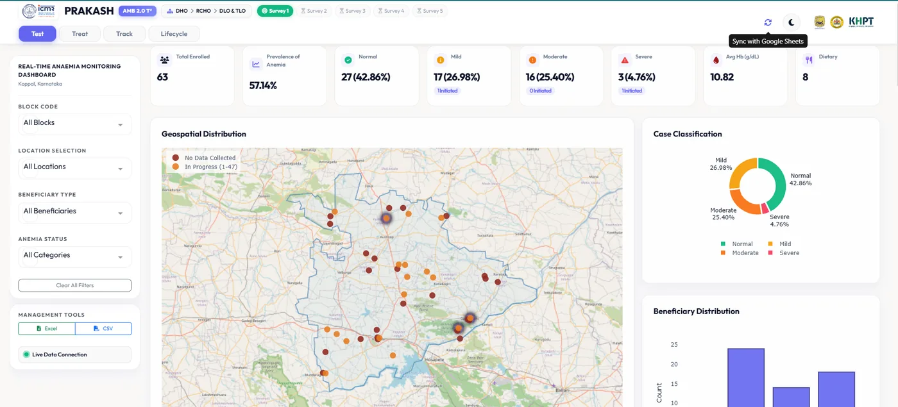</figure><div class="p-cap"><h3>District dashboard</h3><p>Anaemia burden by area, with a geographic heat map.</p></div></div><div class="s-item"><figure class="screen" style="--glow:240,150,10;--gx:78%;--gy:85%">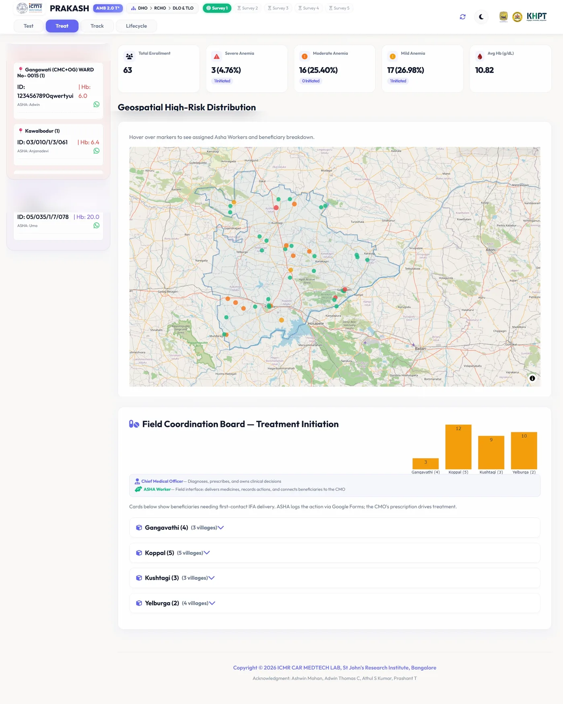</figure><div class="p-cap"><h3>Individual tracker</h3><p>Screening, diagnosis, treatment and follow-up for each person.</p></div></div><div class="s-item"><figure class="screen" style="--glow:10,190,235;--gx:78%;--gy:85%">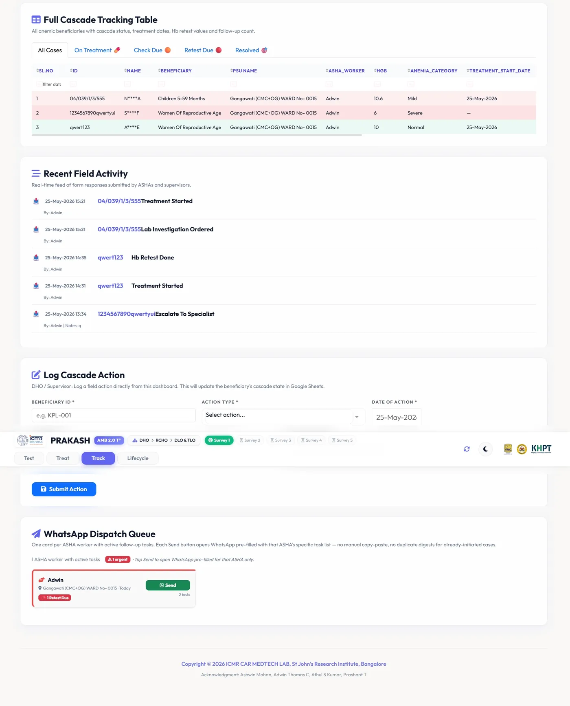</figure><div class="p-cap"><h3>ASHA coordination board</h3><p>Worker-level monitoring of follow-up and treatment.</p></div></div>
</div>
```

### Data protection

The study runs under institutional ethics approval, with written consent before any data is collected. Personal identifiers sit only in the access-controlled database, are never shown on the dashboards and are removed before results are published. The platform is designed to Digital Personal Data Protection Act principles, with access logging.

### Open design questions

The team lists what is not yet solved. There is no state yet for a person who becomes untrackable, such as someone who moves away. Resolution rests on a single retest, which a second confirmatory test would strengthen. The retest is logged by the same worker whose compliance is being reviewed, and the system describes only people who reach a screening point in the first place. A description of the architecture is in preparation as a perspective paper.

## Hospital systems

Two systems built for St. John's Medical College Hospital, in daily use and reporting back to the hospital. Both are written for the staff who run the wards and theatres, and both produce regular performance reports.

### Bed management system

Live bed occupancy for every ward, with department census and service-request tracking.

```{=html}
<div class="dv-facts" style="grid-template-columns:repeat(auto-fit,minmax(150px,1fr))">
<div><b>67</b><span>Wards tracked</span><em>43 departments</em></div>
<div><b>53.3%</b><span>Average ward occupancy</span><em>26 weeks, 12 Mar – 31 Aug 2026</em></div>
<div><b>70%</b><span>Of occupied beds in common wards</span><em>30% in private wards</em></div>
</div>
```

The report for 12 March to 31 August 2026 shows general medicine carrying the highest load of any department, with several smaller departments routinely holding more patients than their dedicated beds. Occupancy was 56.2% on 1 September, against functional beds.

```{=html}
<div class="chart-grid">
<figure class="chart">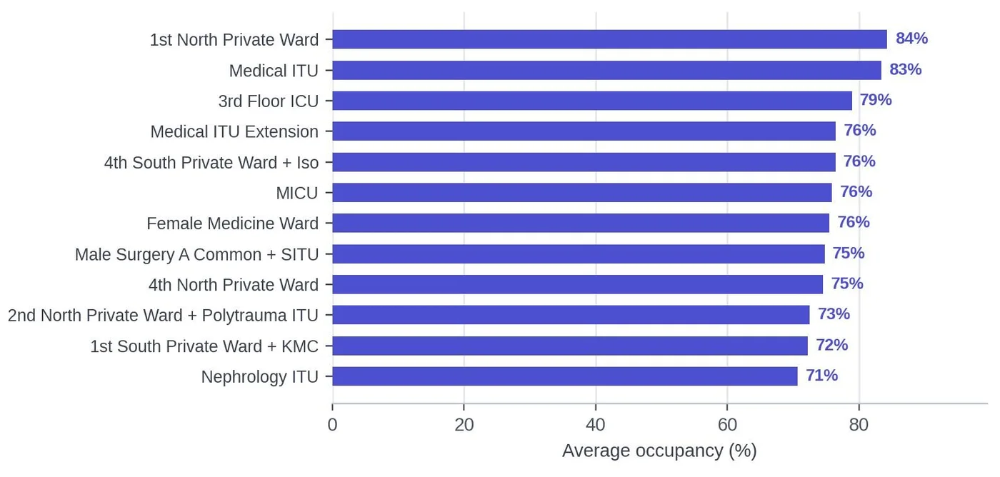<figcaption>Average occupancy of the busiest wards, 12 March to 31 August 2026.</figcaption></figure><figure class="chart">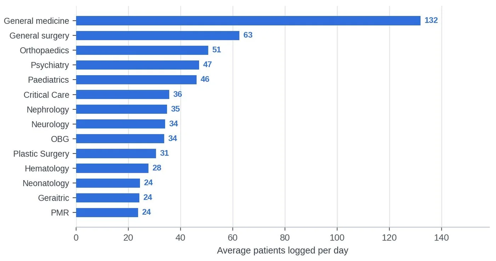<figcaption>Average patients per day by department.</figcaption></figure><figure class="chart">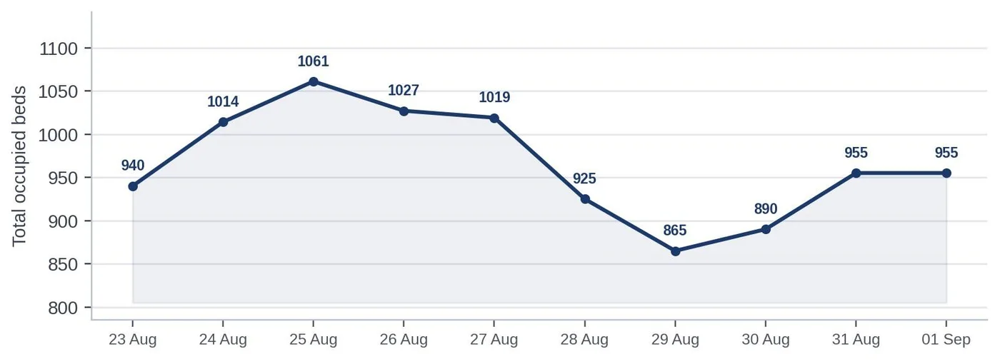<figcaption>Total occupied beds over ten days, each ward carried forward to its last logged reading.</figcaption></figure><figure class="chart">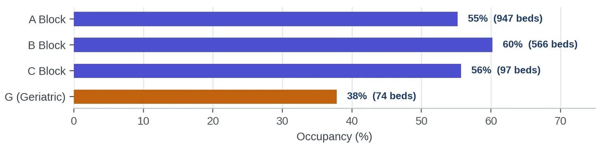<figcaption>Occupancy by hospital block.</figcaption></figure>
</div>
<div class="screen-grid">
<div class="s-item"><figure class="screen" style="--glow:18,190,130;--gx:78%;--gy:85%">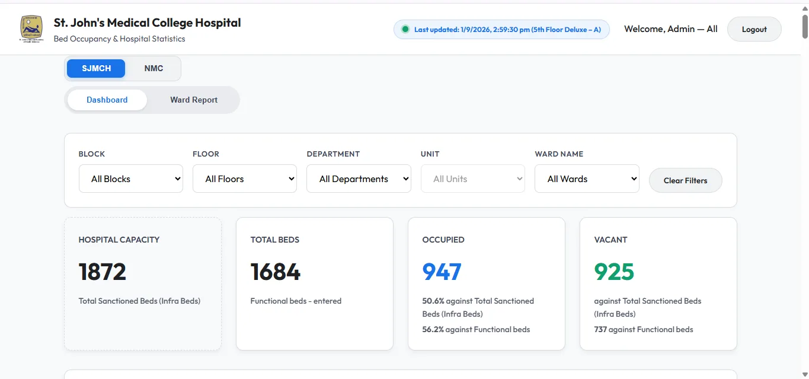</figure><div class="p-cap"><h3>Live bed overview</h3><p>Live occupancy across blocks and wards.</p></div></div><div class="s-item"><figure class="screen" style="--glow:240,150,10;--gx:78%;--gy:85%">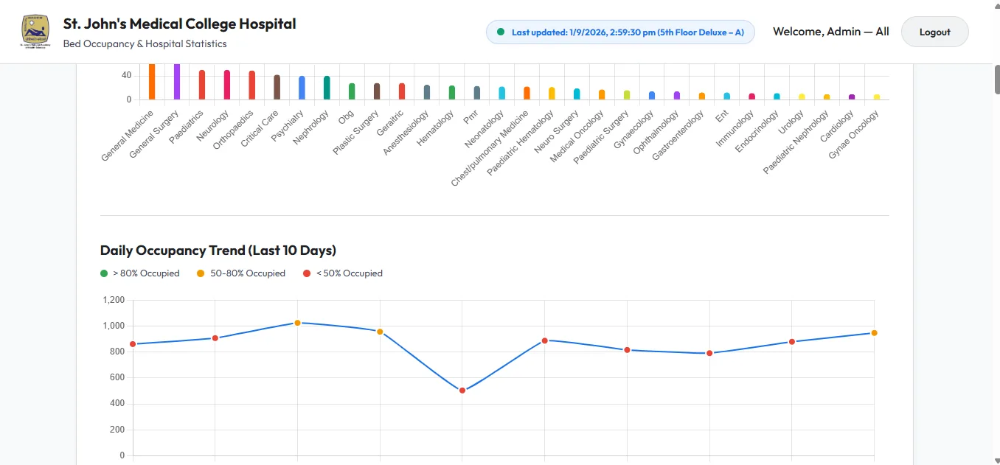</figure><div class="p-cap"><h3>Occupancy trend</h3><p>Daily occupancy over the last ten days.</p></div></div>
</div>
```

### Operation theatre management system

Registers each surgical case and follows it through the theatre day, from pre-op to recovery. The analytics turn the register into utilisation, volume and quality figures.

```{=html}
<div class="dv-facts" style="grid-template-columns:repeat(auto-fit,minmax(150px,1fr))">
<div><b>44</b><span>Theatre rooms</span><em>Across 40+ departments</em></div>
<div><b>1,415</b><span>Cases logged</span><em>5 Aug – 1 Sep 2026</em></div>
<div><b>89%</b><span>Reached completed status</span><em>4.5% cancelled</em></div>
<div><b>1h 52m</b><span>Average duration</span><em>Recovery stay 47 min, target 60</em></div>
</div>
```

General surgery, orthopaedics and ophthalmology together made up over half of all cases. Seven in ten cases were planned elective surgery and 23% were emergencies. Most cancellations traced to entry mistakes rather than clinical reasons, which is the kind of finding the register is meant to expose.

```{=html}
<div class="chart-grid">
<figure class="chart wide">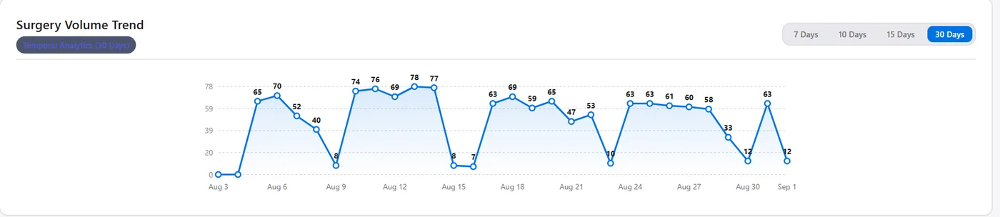<figcaption>Daily surgery volume over the last 30 days.</figcaption></figure><figure class="chart">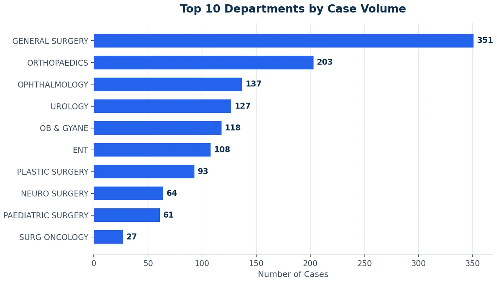<figcaption>Cases by department.</figcaption></figure><figure class="chart">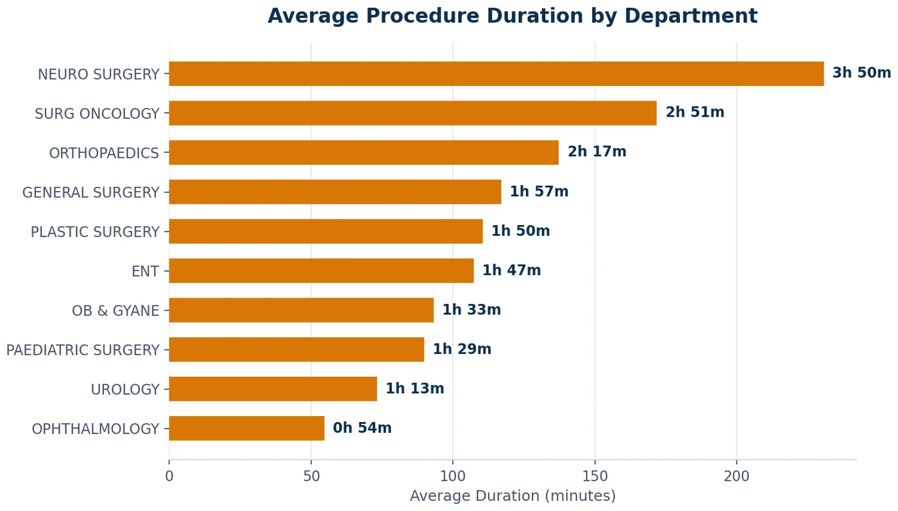<figcaption>Average duration by department.</figcaption></figure><figure class="chart">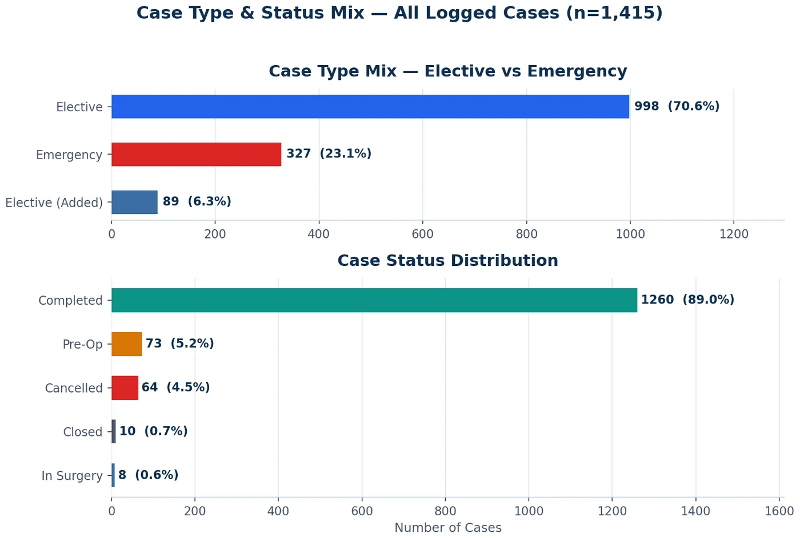<figcaption>Elective and emergency mix, and case status.</figcaption></figure><figure class="chart">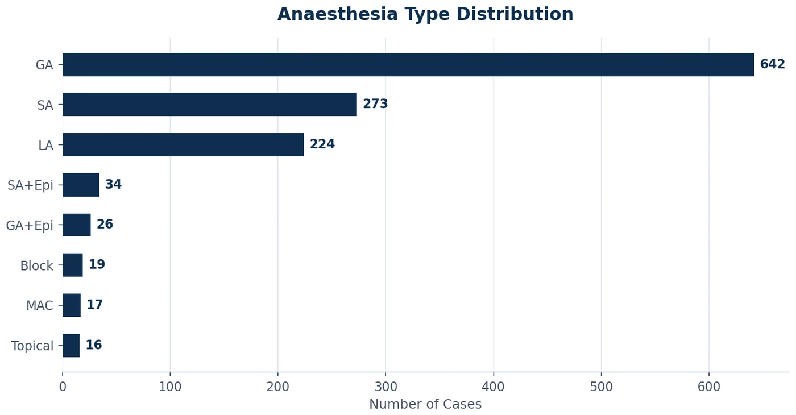<figcaption>Anaesthesia type in completed cases.</figcaption></figure>
</div>
<div class="screen-grid">
<div class="s-item"><figure class="screen" style="--glow:10,190,235;--gx:78%;--gy:85%">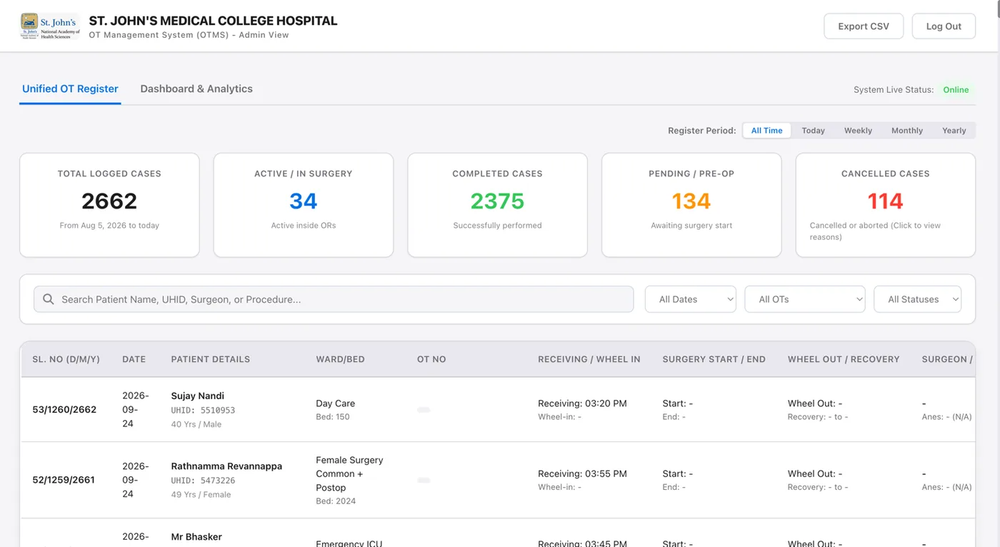</figure><div class="p-cap"><h3>Case register</h3><p>Registering cases and tracking them through the theatre day.</p></div></div><div class="s-item"><figure class="screen" style="--glow:18,190,130;--gx:78%;--gy:85%">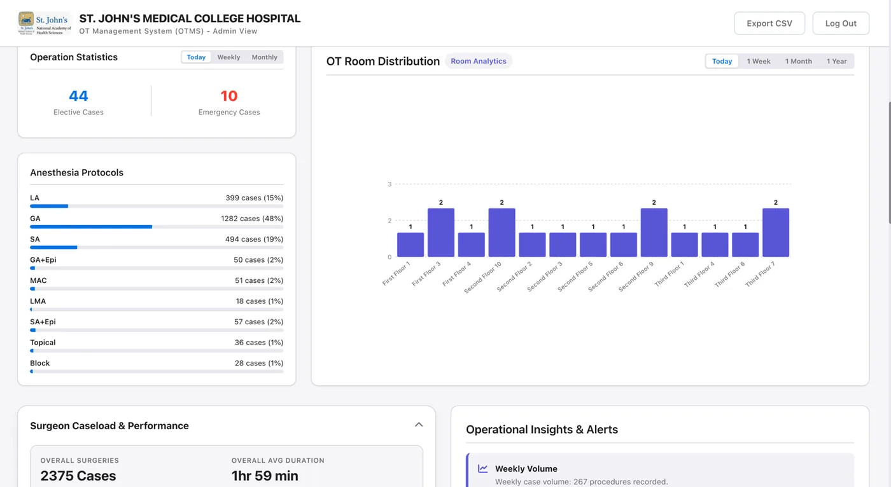</figure><div class="p-cap"><h3>Theatre analytics</h3><p>Case volume, room distribution and anaesthesia statistics.</p></div></div>
</div>
```

## Activity classification

A model that classifies what a toddler is doing from a wrist or hip accelerometer, built on the ActiGraph GT3X for studies that measure physical activity in early childhood. Standard cut-point methods give only sedentary, light and vigorous. A child being carried and a child playing quietly can produce similar overall movement, so the model works from the raw signal instead.

- **Data.** Raw tri-axial acceleration at 80 Hz, cut into 15-second windows, each tied to one child and one directly observed activity. The analysis covers 59 children at about 12, 24 and 36 months, with 26,235 windows.
- **Five activities.** Sedentary, light play, moderate-to-vigorous activity, being carried (non-ambulatory high) and gentle movement (non-ambulatory low).
- **Measures.** Alongside the standard activity count, 73 measures describe the signal: strength and spread, regularity, rhythm across frequency bands, and coordination between directions.
- **Models.** A random forest of 300 trees, compared with a multinomial logistic regression and a baseline that always guesses the commonest activity. Rarer activities carry more weight in training, with no synthetic data added.
- **Testing on unseen children.** Leave-one-child-out validation: the model is trained on every child except one and tested on that child, repeated 59 times, with settings chosen only on the training children. Splitting by time window can overstate accuracy because a model learns a child's own movement pattern.
- **Comparison and checks.** Results are compared with the published toddler cut-points of Trost, scored by macro-F1 so rare activities count equally, with bootstrap confidence intervals over children and eleven planned sensitivity analyses.

```{=html}
<div class="chart-grid">
<figure class="chart wide">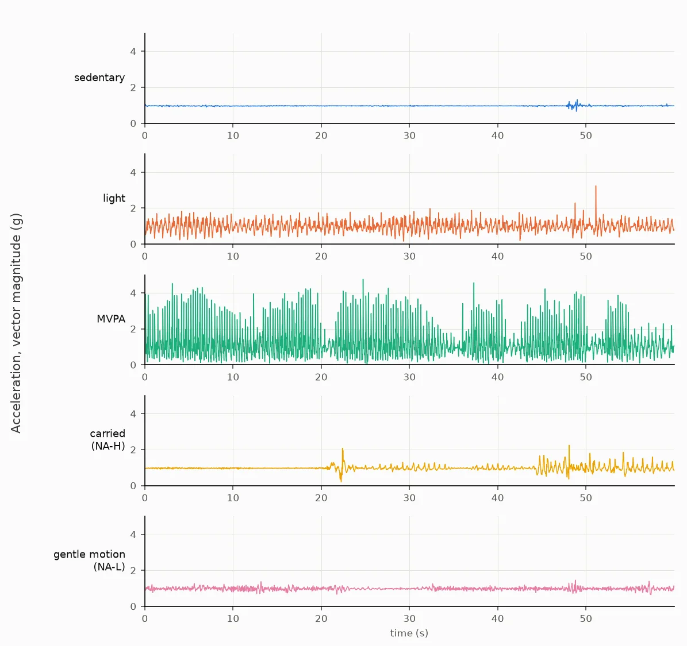<figcaption>One minute of raw acceleration for each activity in a 2-year-old. Sitting and gentle movement stay near 1 g, carrying shows bursts, and running and climbing show repeated high peaks.</figcaption></figure><figure class="chart">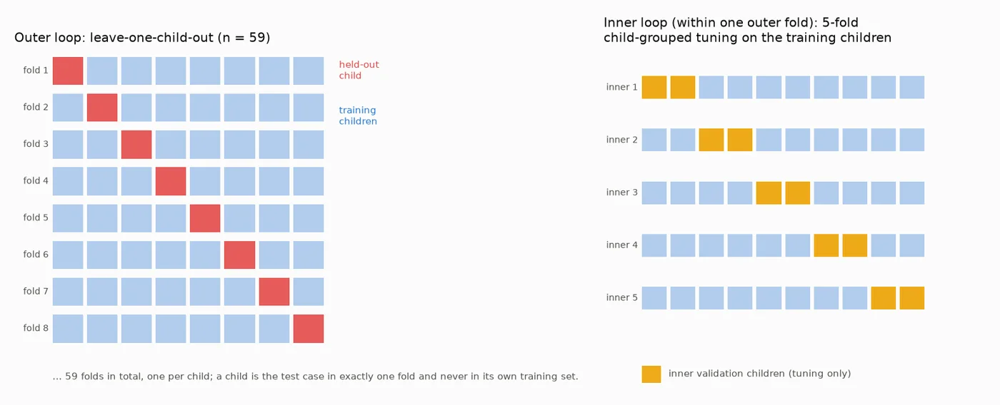<figcaption>Testing design. In each round one child is held out, and settings are tuned on the remaining children only.</figcaption></figure><figure class="chart">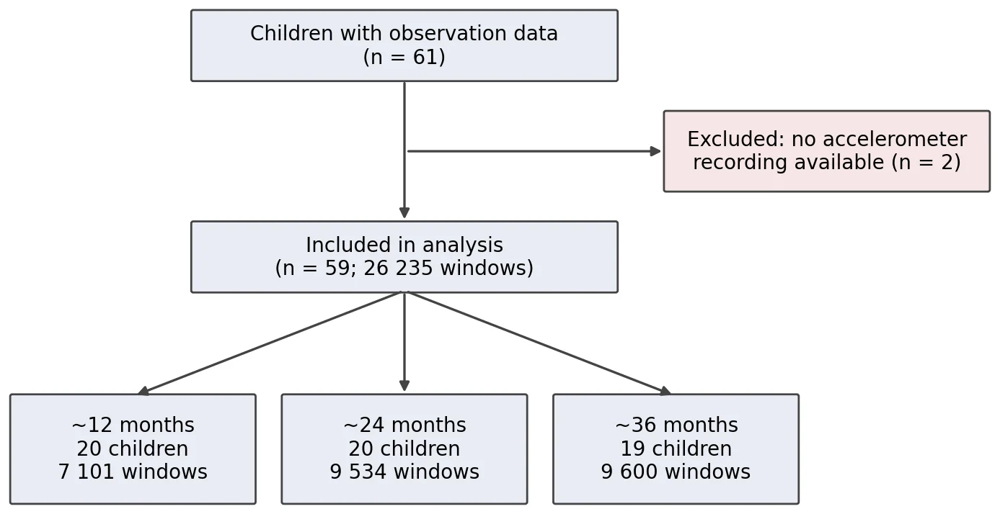<figcaption>Children and windows included in the analysis, by age group.</figcaption></figure><figure class="chart">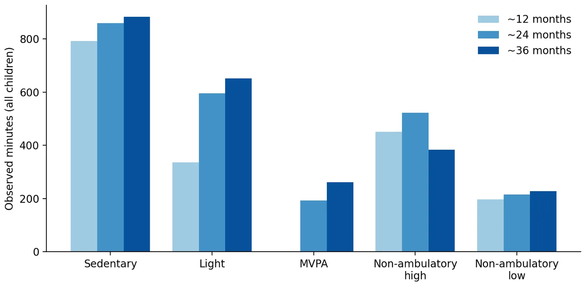<figcaption>Observed minutes of each activity by age group.</figcaption></figure>
</div>
```

## Other software

Built in-house for the hospital and the centre's studies.

```{=html}
<div class="screen-grid">
<div class="s-item"><figure class="screen" style="--glow:240,150,10;--gx:78%;--gy:85%">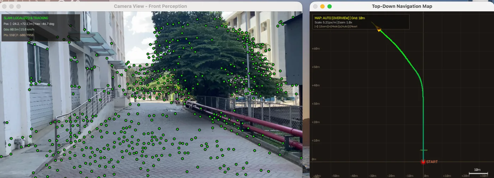</figure><div class="p-cap"><h3>Visual SLAM</h3><p>Camera-based mapping and navigation, tested on a campus walkway.</p></div></div><div class="s-item"><figure class="screen" style="--glow:10,190,235;--gx:78%;--gy:85%">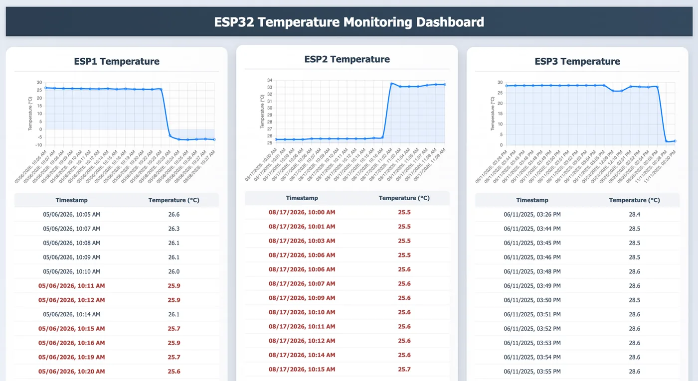</figure><div class="p-cap"><h3>Temperature monitoring</h3><p>ESP32 sensors logging temperature, viewed live and as tables.</p></div></div>
</div>
```

Also a data repository for the Division of Molecular Sciences, and a digital key management system for the hospital, which is planned.

## Team

```{=html}
<div class="gteam"><p class="gnote">Group lead</p><div class="gteam-lead"><a class="gmini" href="../people/index.html#ashwin-mohan"><figure class="pface sm">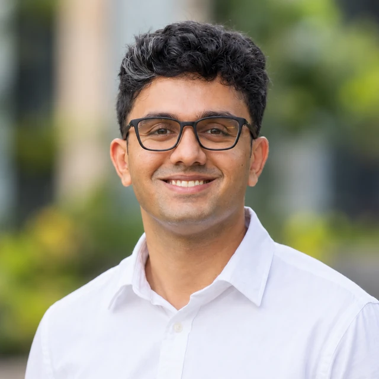</figure><span><strong>Ashwin Mohan</strong><em>Project Research Scientist II</em></span></a></div><p class="gnote">Members</p><div class="gteam-grid"><a class="gmini" href="../people/index.html#adwin-thomas-c"><figure class="pface sm"></figure><span><strong>Adwin Thomas C</strong><em>Data Scientist</em></span></a><a class="gmini" href="../people/index.html#athul-s-kumar"><figure class="pface sm"></figure><span><strong>Athul S Kumar</strong><em>Data Scientist</em></span></a></div></div>
```

```{=html}
<script>
(function(){
  var main=document.getElementById('quarto-document-content'); if(!main) return;
  var secs=[].slice.call(main.querySelectorAll(':scope > section.level2')); if(secs.length<2) return;
  var bar=document.createElement('div'); bar.className='gtabs'; bar.setAttribute('role','tablist');
  secs[0].parentNode.insertBefore(bar,secs[0]);
  function show(i,push){secs.forEach(function(s,j){s.classList.toggle('gpanel-on',j===i)});[].forEach.call(bar.children,function(b,j){b.setAttribute('aria-selected',j===i);b.classList.toggle('on',j===i)});if(push)history.replaceState(null,'','#'+secs[i].id)}
  secs.forEach(function(s,i){var h=s.querySelector(':scope > h2'); var b=document.createElement('button'); b.type='button'; b.setAttribute('role','tab'); b.textContent=h?h.textContent:('Tab '+(i+1)); b.onclick=function(){show(i,true)}; bar.appendChild(b); s.classList.add('gpanel')});
  var start=0; secs.forEach(function(s,i){if(location.hash==='#'+s.id)start=i}); show(start,false);
})();
</script>
```