## Overview

India's medical device sector is growing quickly, driven by healthcare need, new technology and demand for affordable care. The Make in India programme and the National Medical Devices Policy, 2023 give a framework for domestic manufacturing and innovation. A device is not finished when the prototype works. It needs characterisation, performance testing, safety assessment and, where applicable, clinical evaluation before it can enter practice.

The **Centre for Advanced Research (CAR) on Medical Devices Development, Characterization and Validation** at St. John's Research Institute, in collaboration with St. John's Medical College and Hospital, supports that path. It runs from 2024 to 2029, with Prof. Prashanth Thankachan as Programme Director.

The Centre works with clinicians, researchers, engineers and innovators to find unmet clinical needs, then to develop, characterise, test and clinically validate devices. Design is refined, prototypes are built and performance is assessed in relevant clinical settings, so that promising indigenous technologies reach patients with evidence behind them.

```{=html}
<div class="dv-facts">
<div><b>3</b><span>Places the work happens</span><em>Validation, Makers Lab, Rehabilitation Lab</em></div>
<div><b>9</b><span>External devices in validation</span><em>From industry and academia</em></div>
<div><b>18</b><span>Devices built in-house</span><em>Deployed, in testing, in development</em></div>
</div>
```

## Validation

Devices come from industry partners, academic institutions and innovators, across diagnostic imaging, neonatal care, neurology, surgery and rehabilitation. Each is evaluated for its intended use, technical characteristics and stage of development. Depending on the device that can include functional testing, performance characterisation, usability assessment, protocol development and clinical evaluation.

```{=html}
<div class="vlist"><article class="vc vc-done"><span class="vc-n">01</span><div class="vc-main"><h4>Lenek Intelligent Radiology Assistant (LIRA)</h4><p class="vc-by">LENEK Technologies, IIT Kanpur</p><p>AI software that assists tuberculosis screening and chest X-ray interpretation in adults. The study measured diagnostic accuracy against microbiological reference standards and radiologist reads. The report and manuscript are with ICMR for review.</p></div><div class="vc-side"><span class="vc-chip">Retrospective study complete</span><p><span>Licence</span>CDSCO test licence received before the study began.</p></div></article><article class="vc vc-todo"><span class="vc-n">02</span><div class="vc-main"><h4>LeXIS portable X-ray system</h4><p class="vc-by">LENEK Technologies</p><p>A portable radiography system for use by qualified radiographers in homes, clinics, hospitals and outdoor health camps, for adults and children over two. The validation at St. John&#x27;s will test agreement with established X-ray devices.</p></div><div class="vc-side"><span class="vc-chip">Study yet to start</span><p><span>Licence</span>CDSCO test licence and radiation certificate for the hardware obtained.</p></div></article><article class="vc vc-on"><span class="vc-n">03</span><div class="vc-main"><h4>nLite360 intelligent phototherapy</h4><p class="vc-by">Hemac Healthcare Pvt. Ltd.</p><p>A neonatal phototherapy device for jaundice from unconjugated hyperbilirubinaemia. Three LED panels (two above the bassinet, one below) give single-surface, double-surface or high-intensity treatment, and the light source detaches so phototherapy can continue during feeding. A randomised controlled trial in neonates of 35 weeks or more compares it with conventional phototherapy on bilirubin reduction rate, treatment duration, temperature regulation, safety, usability and maternal feedback.</p></div><div class="vc-side"><span class="vc-chip">Ongoing trial</span><p><span>Licence</span>CDSCO test and safety licences received.</p></div></article><article class="vc vc-todo"><span class="vc-n">04</span><div class="vc-main"><h4>Nemocare Raksha (Svasa)</h4><p class="vc-by">Nemocare</p><p>A wireless, foot-worn vital-signs monitor for newborns including preterm infants, compatible with kangaroo mother care. The study will test agreement with reference monitors, signal coverage, detection of critical events, safety and performance across term and preterm neonates.</p></div><div class="vc-side"><span class="vc-chip">Study yet to start</span><p><span>Licence</span>CDSCO test and safety licences yet to be received.</p></div></article><article class="vc vc-todo"><span class="vc-n">05</span><div class="vc-main"><h4>Radiofrequency ablation needle for PCOS</h4><p class="vc-by">Malpani Infertility Clinic</p><p>A sterile, single-use monopolar electrode for ultrasound-guided transvaginal ovarian ablation in women with PCOS-related infertility who do not respond to first-line drugs. The investigation will assess procedural safety, technical success, ovulation, menstrual regularity, ovarian function and operator usability.</p></div><div class="vc-side"><span class="vc-chip">Study yet to start</span><p><span>Licence</span>CDSCO test licence received. Safety licence (IEC 60601-1, IEC 60601-2-2) received; biocompatibility test pending.</p></div></article><article class="vc vc-todo"><span class="vc-n">06</span><div class="vc-main"><h4>Reusable adjustable biopsy gun</h4><p class="vc-by">BETIC, IIT Bombay</p><p>A sterilisable biopsy gun with automatic firing, a loading-status display and ergonomic firing knobs. It will be compared with a standard commercial gun on safety, sample adequacy, procedural performance and complications.</p></div><div class="vc-side"><span class="vc-chip">Study yet to start</span><p><span>Licence</span>CDSCO test licence received. Safety licence (IEC 60601-1) received; biocompatibility test pending.</p></div></article><article class="vc vc-todo"><span class="vc-n">07</span><div class="vc-main"><h4>Menteve EEG-MED 32</h4><p class="vc-by">Menteve Health Pvt. Ltd.</p><p>A portable point-of-care EEG with a wearable cap of pre-installed gel electrodes, built for quick setup and portable use. It will be compared with a standard clinical EEG on signal quality, diagnostic agreement, usability, recording time and patient comfort.</p></div><div class="vc-side"><span class="vc-chip">Study yet to start</span><p><span>Licence</span>CDSCO test licence received. Safety licence yet to be received.</p></div></article><article class="vc vc-todo"><span class="vc-n">08</span><div class="vc-main"><h4>MOF articulating laparoscopic instrument</h4><p class="vc-by">BETIC, IIT Bombay</p><p>A reusable instrument for minimally invasive surgery that grasps, dissects, cauterises and coagulates with added manoeuvrability. It awaits clinical comparison with conventional instruments on safety, surgical performance, operative time, dexterity, usability and complications.</p></div><div class="vc-side"><span class="vc-chip">Study yet to start</span><p><span>Licence</span>CDSCO test licence received. Safety licence (IEC 60601-1, IEC 60601-2-2) and biocompatibility test pending.</p></div></article><article class="vc vc-todo"><span class="vc-n">09</span><div class="vc-main"><h4>Logic Boots AI-powered stethoscope</h4><p class="vc-by">Logic Boots</p><p>Acoustic sensing and AI to help screen for pneumonia, tuberculosis and cardiac abnormalities. The team has held several rounds of discussion with the innovators and is guiding them through certification and regulation, and the innovators will demonstrate the device to SJRI clinicians.</p></div><div class="vc-side"><span class="vc-chip">Study yet to start</span><p><span>Licence</span>CDSCO test and safety licences yet to be received.</p></div></article></div>
```

## Makers Lab

The CAR MedTech Makers Lab turns clinical needs and engineering ideas into practical, affordable, user-centred devices. Electronics, 3D printing, rapid prototyping and clinical input come together in one place, and projects range from early concepts to refined prototypes ready for testing. The emphasis is on indigenous development, low cost and customisation. Every device below began as a request from a clinician or a patient.

```{=html}
<div class="dv-stage"><span class="dv-stage-n">01</span><h3>Deployed for use in patients and the laboratory</h3><span class="dv-count">8 devices</span></div><div class="dv-list"><article class="dv"><div class="dv-imgs n4"><figure style="--ar:0.563">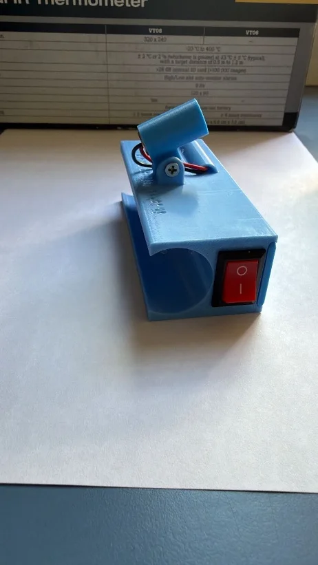</figure><figure style="--ar:0.881">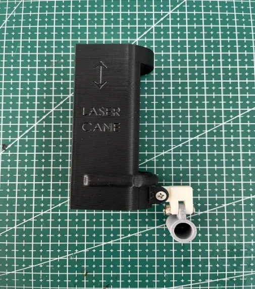</figure><figure style="--ar:0.641">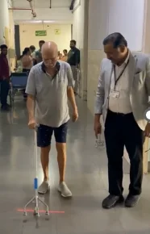</figure><figure style="--ar:0.769">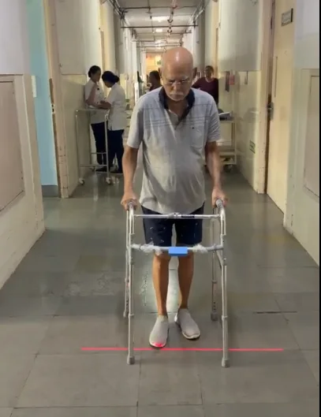</figure></div><div class="dv-body"><span class="dv-n">01</span><h4>Laser cane for stick and walker</h4><p>A laser cane for walking assistance, for people who experience freezing of gait or have difficulty starting a step. A projected line gives a visual target to step over.</p><p class="dv-req"><span>Requested by</span> Dr. Thomas Mathew, Neurologist, SJMCH</p></div></article><article class="dv"><div class="dv-imgs n1"><figure style="--ar:0.785">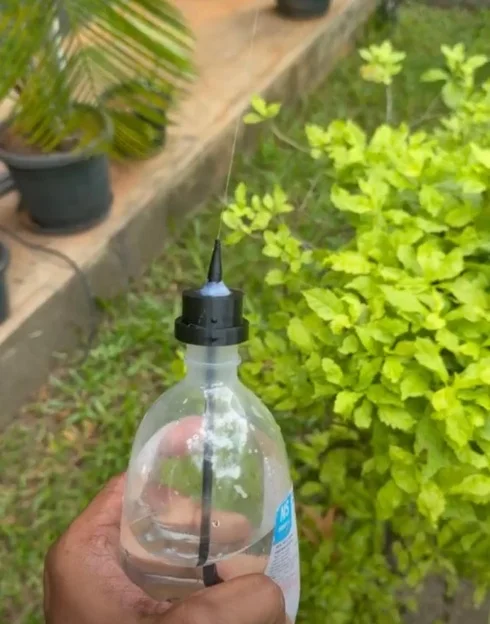</figure></div><div class="dv-body"><span class="dv-n">02</span><h4>Bottle pump for saline</h4><p>A saline dispensing nozzle for a squeezable bottle. Squeezing the bottle forces saline through the nozzle as a controlled jet or stream for oral use.</p><p class="dv-req"><span>Requested by</span> Dr. Thomas Mathew, Neurologist, SJMCH</p></div></article><article class="dv"><div class="dv-imgs n1"><figure style="--ar:0.796">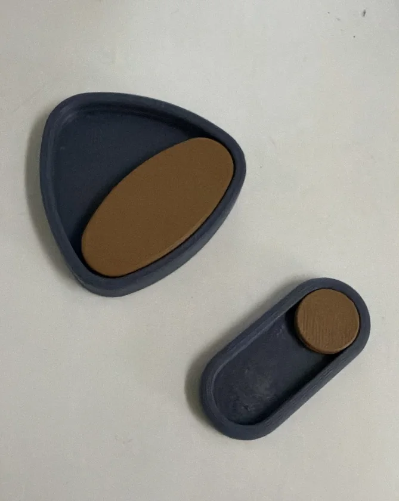</figure></div><div class="dv-body"><span class="dv-n">03</span><h4>Fidget for neurology</h4><p>A fidget for controlled, repetitive tactile hand movement during neurological assessment or rehabilitation. It supports fine motor control, coordination, dexterity, grip and sensory-motor function.</p><p class="dv-req"><span>Requested by</span> Dr. Thomas Mathew, Neurologist, SJMCH</p></div></article><article class="dv"><div class="dv-imgs n2"><figure style="--ar:0.562">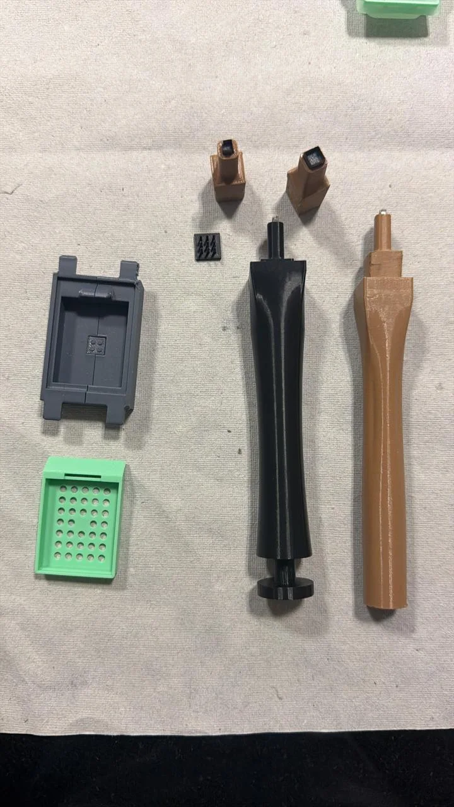</figure><figure style="--ar:0.562">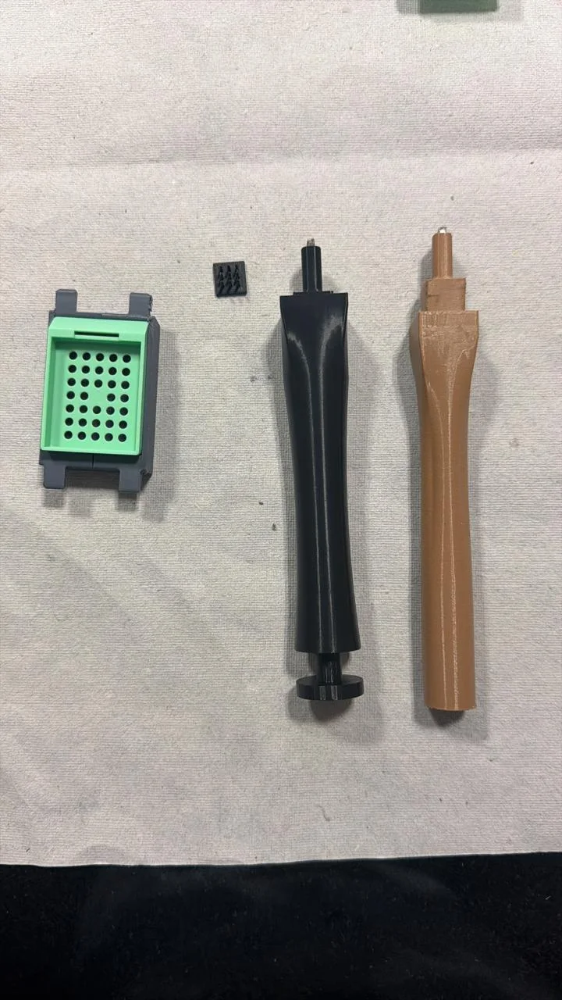</figure></div><div class="dv-body"><span class="dv-n">04</span><h4>Microbiology sample cutter and slide holder</h4><p>A low-cost cube cutter with an ejector, for preparing small, uniform blocks of tissue or specimen. An integrated slide holder keeps the sample steady for microscopy.</p><p class="dv-req"><span>Requested by</span> Dr. Jyothi, Microbiologist, SJMCH</p></div></article><article class="dv"><div class="dv-imgs n2"><figure style="--ar:0.728">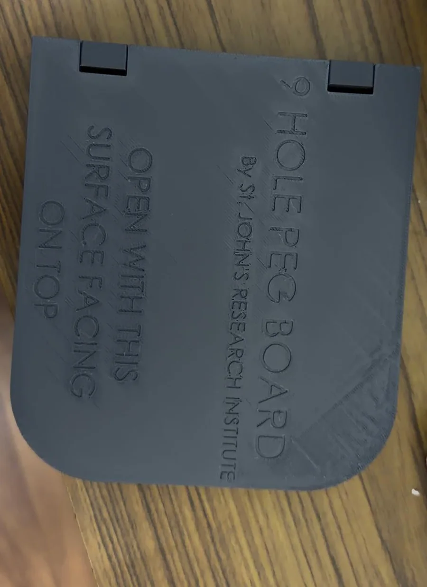</figure><figure style="--ar:0.459">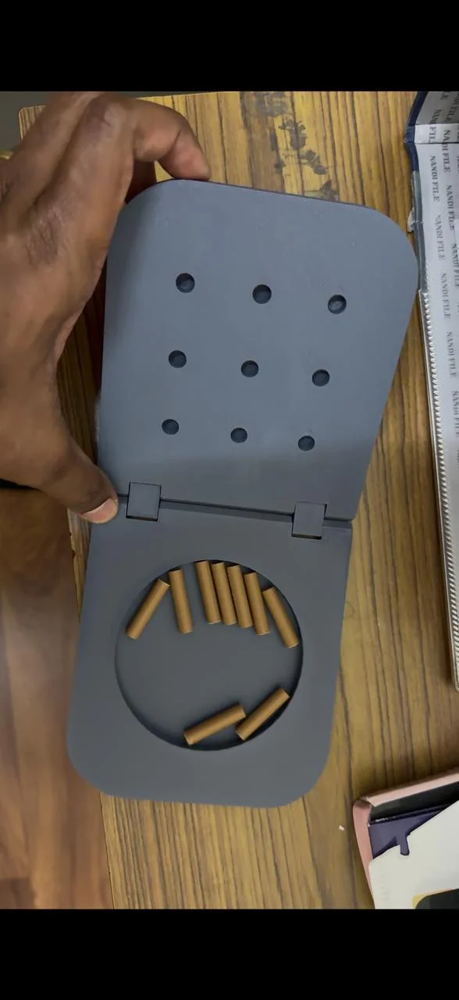</figure></div><div class="dv-body"><span class="dv-n">05</span><h4>Nine-hole peg board</h4><p>A standard hand-function assessment board used in neurology and rehabilitation to measure fine motor coordination, finger dexterity and upper-limb function. Completion time is recorded as the measure.</p><p class="dv-req"><span>Requested by</span> Dr. Thomas Mathew, Neurologist, SJMCH</p></div></article><article class="dv"><div class="dv-imgs n1"><figure style="--ar:0.956">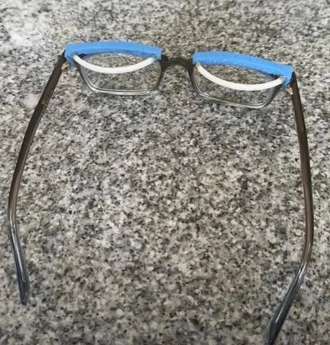</figure></div><div class="dv-body"><span class="dv-n">06</span><h4>Crutch glasses</h4><p>A 3D-printed attachment that clips onto a patient&#x27;s own spectacles and mechanically supports a drooping upper eyelid. A lightweight, personalised, non-surgical and potentially low-cost option for ptosis.</p><p class="dv-req"><span>Requested by</span> Dr. Thomas Mathew, Neurologist, SJMCH</p></div></article><article class="dv"><div class="dv-imgs n2"><figure style="--ar:0.449">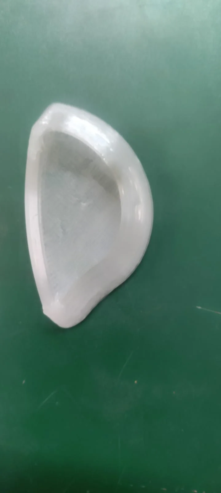</figure><figure style="--ar:0.449">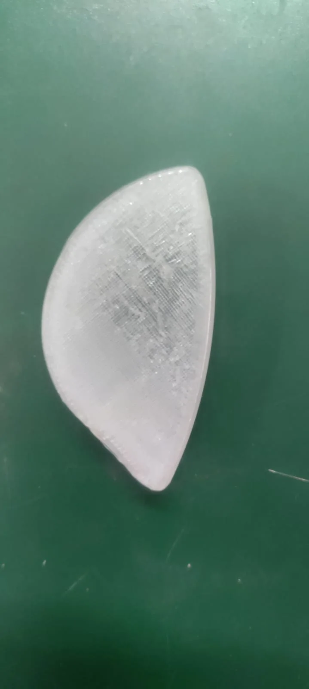</figure></div><div class="dv-body"><span class="dv-n">07</span><h4>Ear cap</h4><p>A 3D-printed cap that covers the ear during a bath or shower. It keeps water out of the ear canal for patients with ear conditions, wounds or post-operative sites.</p><p class="dv-req"><span>Requested by</span> A patient after tympanoplasty</p></div></article><article class="dv"><div class="dv-imgs n2"><figure style="--ar:0.750">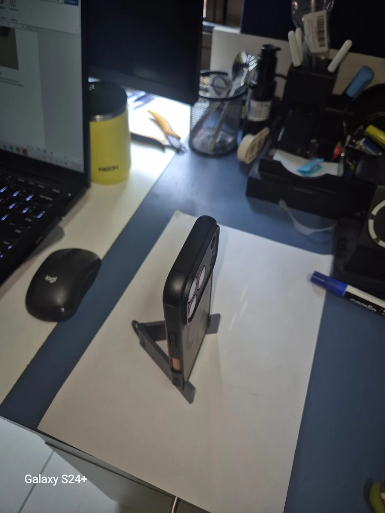</figure><figure style="--ar:0.750">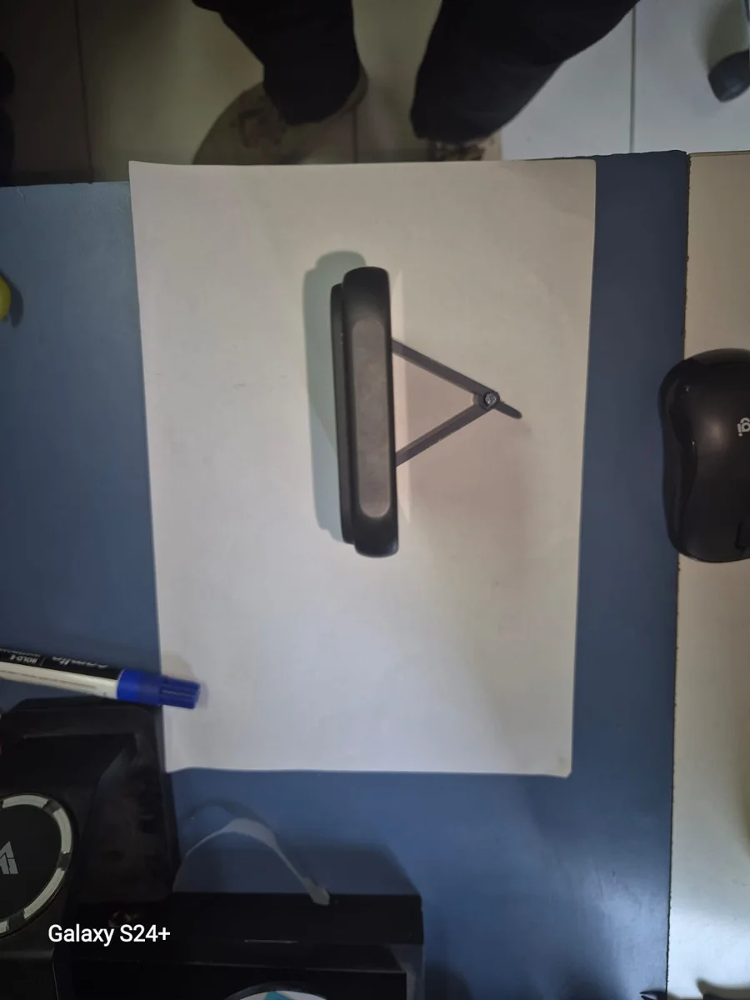</figure></div><div class="dv-body"><span class="dv-n">08</span><h4>90-degree phone holder</h4><p>Holds a smartphone at a right angle so video data can be captured comfortably and consistently.</p><p class="dv-req"><span>Requested by</span> Dr. Anura Krupad, Nutrition, SJMCH</p></div></article></div><div class="dv-stage"><span class="dv-stage-n">02</span><h3>Under testing</h3><span class="dv-count">6 devices</span></div><div class="dv-list"><article class="dv"><div class="dv-imgs n1"><figure style="--ar:1.468">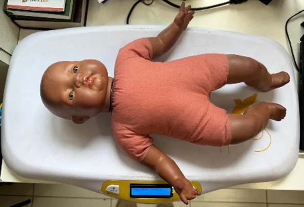</figure></div><div class="dv-body"><span class="dv-n">01</span><h4>Audible baby weighing scale</h4><p>A low-cost digital infant scale that measures weight and announces it aloud. Fewer reading and recording errors, and easier use in busy or low-resource settings.</p><p class="dv-req"><span>Requested by</span> Dr. Prem Mony, Nutrition, SJMCH</p></div></article><article class="dv"><div class="dv-imgs n2"><figure style="--ar:1.535">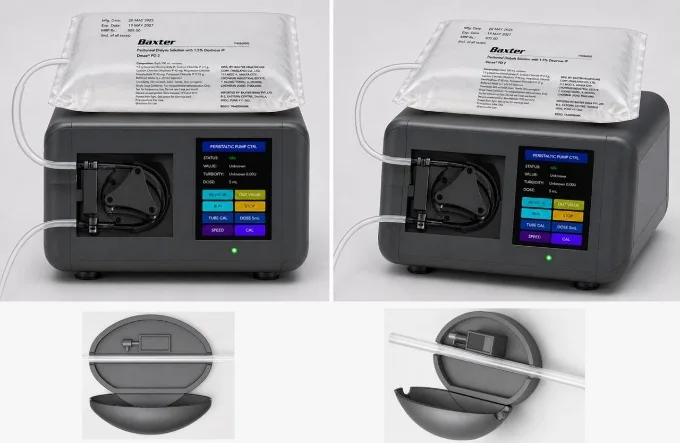</figure><figure style="--ar:1.596">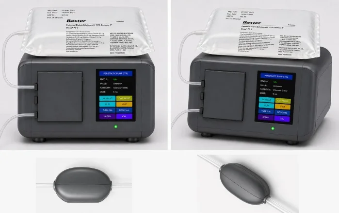</figure></div><div class="dv-body"><span class="dv-n">02</span><h4>Paediatric peritoneal dialysis device</h4><p>A peristaltic pump with pinch valves controls dialysate flow through the fill, dwell and drain cycles. The fluid path is isolated to limit contamination, with pressure and flow monitoring for safety and accuracy in children. Includes the pump, pinch and clam-pinch valves, case and board design.</p><p class="dv-req"><span>Requested by</span> Dr. Prashanth T, Nutrition, SJRI</p></div></article><article class="dv"><div class="dv-imgs n1"><figure style="--ar:0.795">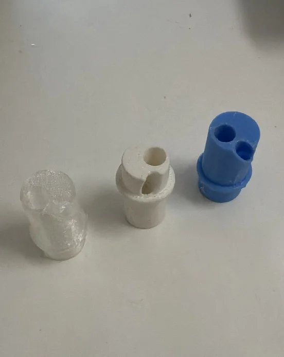</figure></div><div class="dv-body"><span class="dv-n">03</span><h4>Laparoscopy guide unit</h4><p>A compact guide that helps surgeons position and align laparoscopic instruments during minimally invasive procedures in children, improving access and stability.</p><p class="dv-req"><span>Requested by</span> Dr. Kiren, Pediatrician, SJMCH</p></div></article><article class="dv"><div class="dv-imgs n1"><figure style="--ar:0.552">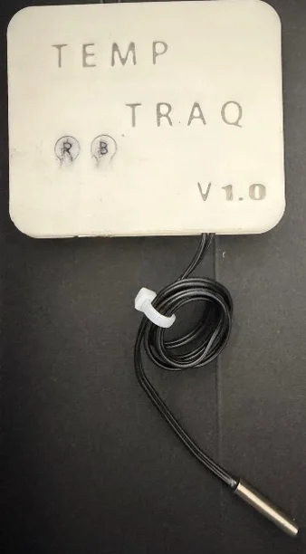</figure></div><div class="dv-body"><span class="dv-n">04</span><h4>Temperature tracker</h4><p>A Wi-Fi-enabled device that measures and records temperature continuously at set intervals.</p><p class="dv-req"><span>Requested by</span> Dr. Prashanth T, Nutrition, SJRI</p></div></article><article class="dv"><div class="dv-imgs n3"><figure style="--ar:0.750">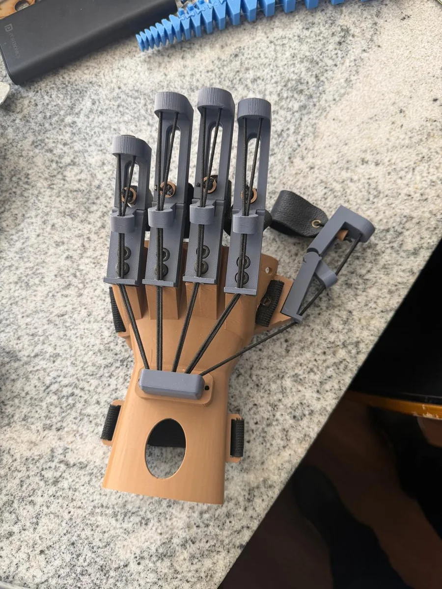</figure><figure style="--ar:0.750">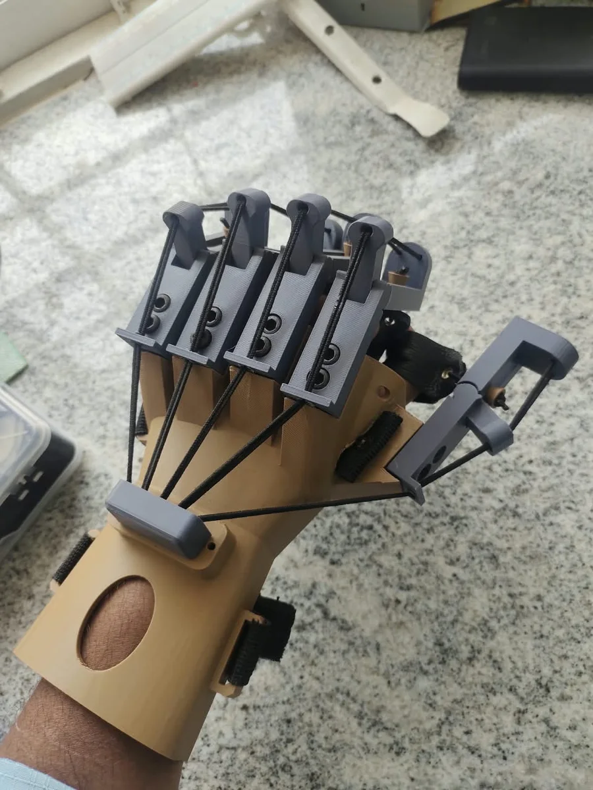</figure><figure style="--ar:1.333">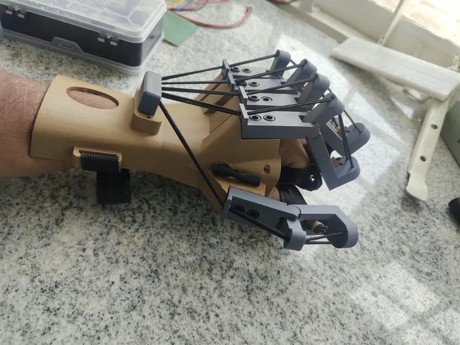</figure></div><div class="dv-body"><span class="dv-n">05</span><h4>Passive hand rehabilitation device</h4><p>Adjustable linkages and elastic elements guide controlled finger and thumb movement. Supports hand mobility, range of motion, coordination and functional recovery.</p><p class="dv-req"><span>Requested by</span> Dr. Prashanth T, Nutrition, SJRI</p></div></article><article class="dv"><div class="dv-imgs n3"><figure style="--ar:0.750">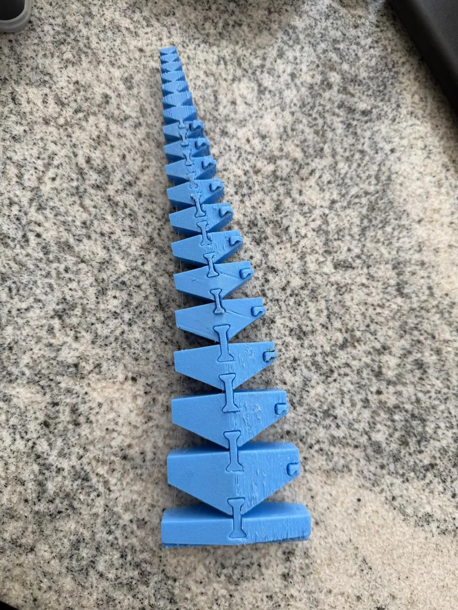</figure><figure style="--ar:1.852">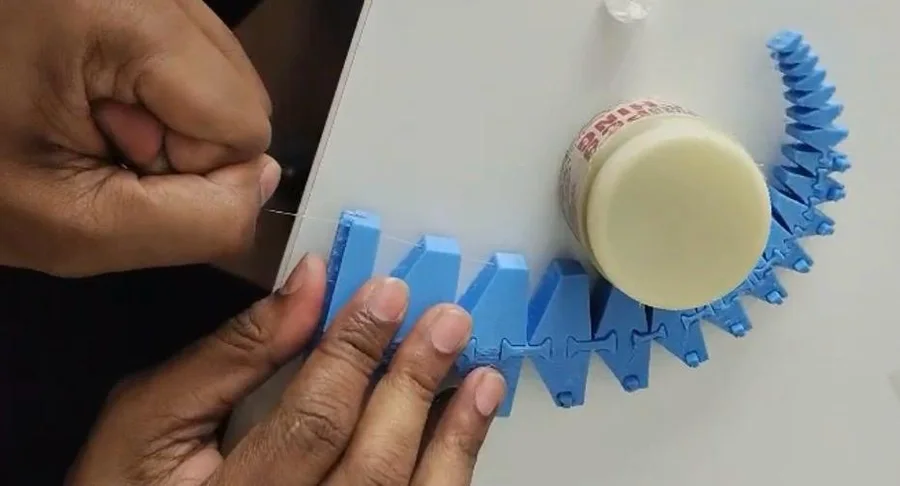</figure><figure style="--ar:1.906">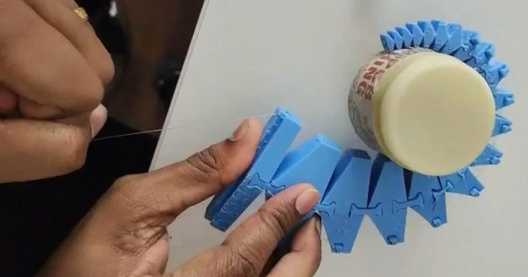</figure></div><div class="dv-body"><span class="dv-n">06</span><h4>Tentacle gripper for pick and place</h4><p>A tentacle-style gripper that handles objects of different shapes and sizes.</p><p class="dv-req"><span>Requested by</span> Dr. Prashanth T, Nutrition, SJRI</p></div></article></div><div class="dv-stage"><span class="dv-stage-n">03</span><h3>Under development</h3><span class="dv-count">4 devices</span></div><div class="dv-list"><article class="dv noimg"><div class="dv-body"><span class="dv-n">01</span><h4>Sit-to-stand inflatable pillow</h4><p>A low-cost inflatable cushion that helps elderly people rise from a chair.</p></div></article><article class="dv noimg"><div class="dv-body"><span class="dv-n">02</span><h4>Valve design</h4><p>A 3D-printed multi-port valve for fluid and air. Flow goes one way and reverse flow is restricted.</p></div></article><article class="dv noimg"><div class="dv-body"><span class="dv-n">03</span><h4>Calf muscle exercise device</h4><p>Controlled strengthening through repeated ankle plantarflexion and dorsiflexion, with adjustable resistance and support. For strengthening, mobility and recovery after injury or neurological impairment.</p><p class="dv-req"><span>Requested by</span> Dr. Thomas Mathew, Neurologist, SJMCH</p></div></article><article class="dv noimg"><div class="dv-body"><span class="dv-n">04</span><h4>Bed weighing scale</h4><p>Load cells in the ICU bed frame weigh a critically ill patient without moving them. Supports medication dosing, fluid management, nutritional assessment and monitoring.</p><p class="dv-req"><span>Requested by</span> Dr. Amarja, ICU, SJMCH</p></div></article></div>
<div class="dv-stage"><span class="dv-stage-n">04</span><h3>Facilities</h3></div>
<p class="dv-fac-intro">Equipment for rapid prototyping, 3D printing, laser fabrication, electronics assembly and basic mechanical work lets the team make custom components and enclosures, integrate electronics and revise a design within days.</p>
<div class="fac"><div><strong>Bambu Lab X1E with AMS</strong><span>Multi-material, multi-colour 3D printing for rapid prototypes, components and custom device parts.</span></div><div><strong>Bambu Lab H2C with laser module</strong><span>3D printing and laser-assisted fabrication for prototypes and custom components.</span></div><div><strong>Soldering station</strong><span>Assembly, soldering and repair of electronic circuits and connections.</span></div><div><strong>Drilling machine</strong><span>Drilling and basic machining of prototype parts and enclosures.</span></div><div><strong>Mini angle cutter</strong><span>Cutting and modifying materials during mechanical fabrication and assembly.</span></div><div><strong>Laser engraver</strong><span>Engraving labels, markings and identification on compatible materials and parts.</span></div><div><strong>Electronics accessories</strong><span>Circuit development, sensor integration, wiring, testing and embedded-system prototyping.</span></div></div>
```

## Rehabilitation Lab

*Rehabilitation and Assistive Device Development Lab, St. John's Medical College and Hospital, Bengaluru*

The lab designs, redesigns and clinically validates affordable rehabilitation and assistive technology, turning unmet clinical needs into practical, patient-centred devices.

Its flagship project is a **low-cost gait rehabilitation device**, first built during Dr. Clinton Wilson's PhD at Vellore Institute of Technology (VIT). Seeing its clinical potential, Prof. Prashanth Thankachan, Principal Investigator of ICMR CAR at St. John's Research Institute, and Dr. Thomas Mathew, Neurologist at St. John's Medical College and Hospital, championed taking it towards clinical use. With the support of St. John's leadership, dedicated space was set aside for further development, clinical validation, design refinement and a route to commercialisation. The work is a collaboration between VIT and St. John's.

```{=html}
<div class="rl-gallery">
<figure class="rl-a">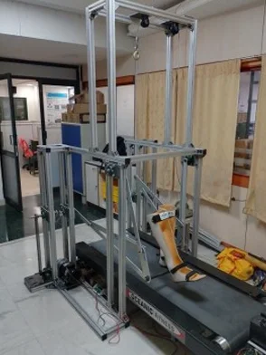</figure>
<figure class="rl-b">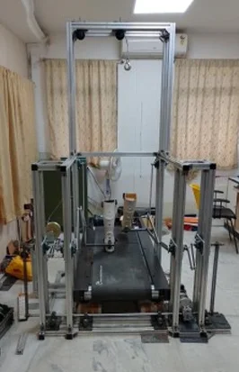</figure>
<figure class="rl-c">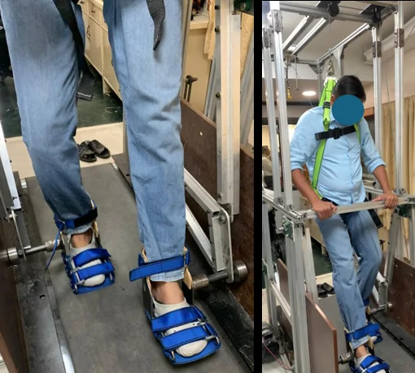</figure>
</div>
```

Beyond gait, the lab is a platform for **low-cost assistive devices** that address functional, mobility and rehabilitation needs. Dr. Thomas Mathew's clinical input identifies unmet needs, guides design and keeps development tied to the practical problems patients and clinicians face.

## Team

```{=html}
<div class="gteam"><p class="gnote">Group lead</p><div class="gteam-lead"><a class="gmini" href="../people/index.html#clinton-wilson"><figure class="pface sm">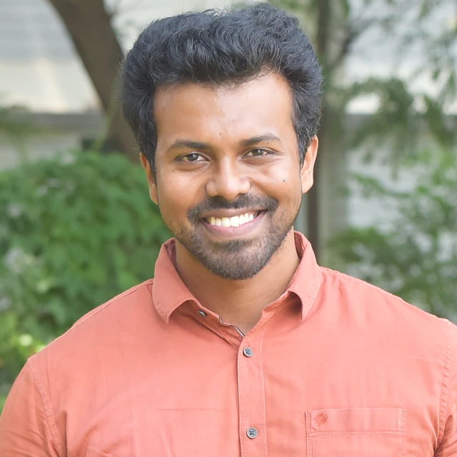</figure><span><strong>Clinton Wilson Barnabas V</strong><em>Project Research Scientist III (Non-Medical)</em></span></a></div><p class="gnote">Members</p><div class="gteam-grid"><a class="gmini" href="../people/index.html#sowmya-hr"><figure class="pface sm">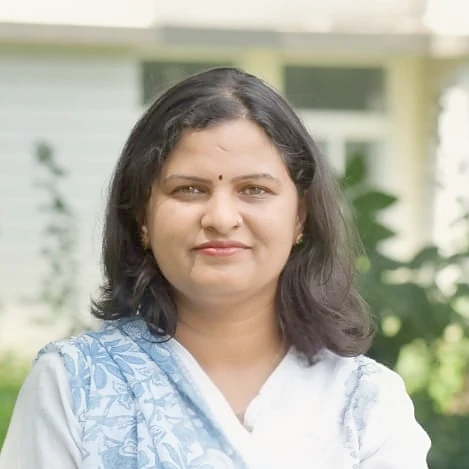</figure><span><strong>Sowmya H. R.</strong><em>Project Research Scientist II · Project Manager</em></span></a><a class="gmini" href="../people/index.html#yogananth-sakthivel"><figure class="pface sm">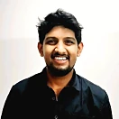</figure><span><strong>Yogananth Sakthivel</strong><em>Project Technical Support III</em></span></a><a class="gmini" href="../people/index.html#soundarya-ts"><figure class="pface sm"></figure><span><strong>Soundarya T S</strong><em>Project Technical Support II</em></span></a><a class="gmini" href="../people/index.html#sneha-ann-shibu"><figure class="pface sm">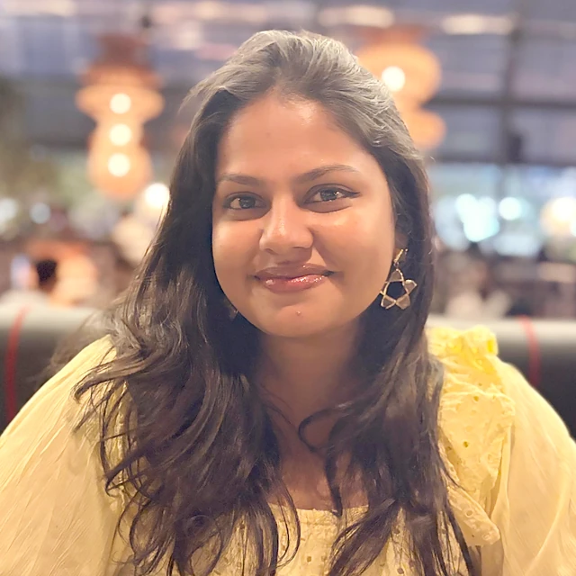</figure><span><strong>Sneha Ann Shibu</strong><em>Project Technical Support III</em></span></a><a class="gmini" href="../people/index.html#pavan-s"><figure class="pface sm">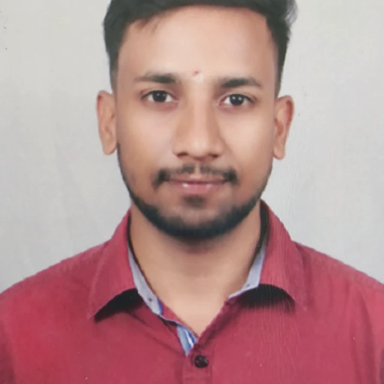</figure><span><strong>Pavan S</strong><em>Senior Project Assistant</em></span></a><a class="gmini" href="../people/index.html#hadlee"><figure class="pface sm">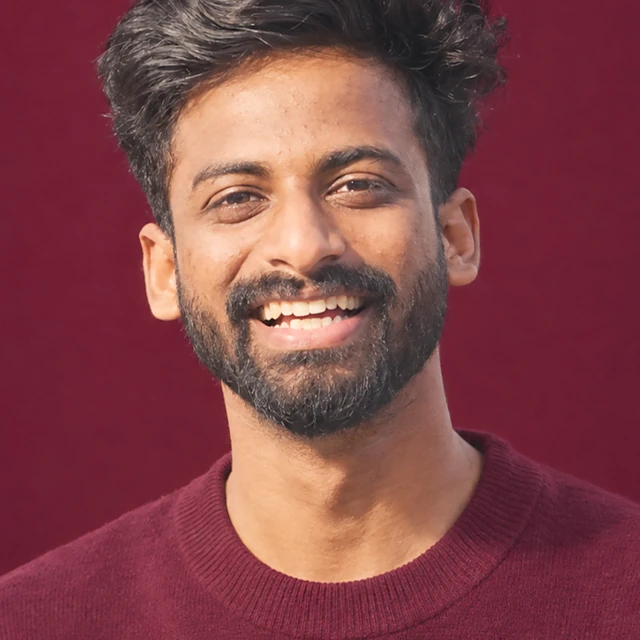</figure><span><strong>Hadlee</strong><em>Data Entry Operator</em></span></a><a class="gmini" href="../people/index.html#sisira-m"><figure class="pface sm">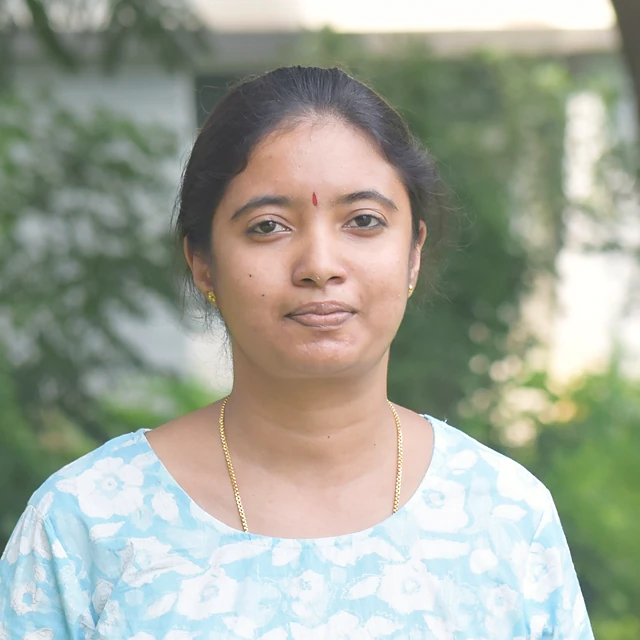</figure><span><strong>Sisira M</strong><em>Data Entry Operator</em></span></a></div></div>
```

```{=html}
<script>
(function(){
  var main=document.getElementById('quarto-document-content'); if(!main) return;
  var secs=[].slice.call(main.querySelectorAll(':scope > section.level2')); if(secs.length<2) return;
  var bar=document.createElement('div'); bar.className='gtabs'; bar.setAttribute('role','tablist');
  secs[0].parentNode.insertBefore(bar,secs[0]);
  function show(i,push){secs.forEach(function(s,j){s.classList.toggle('gpanel-on',j===i)});[].forEach.call(bar.children,function(b,j){b.setAttribute('aria-selected',j===i);b.classList.toggle('on',j===i)});if(push)history.replaceState(null,'','#'+secs[i].id)}
  secs.forEach(function(s,i){var h=s.querySelector(':scope > h2'); var b=document.createElement('button'); b.type='button'; b.setAttribute('role','tab'); b.textContent=h?h.textContent:('Tab '+(i+1)); b.onclick=function(){show(i,true)}; bar.appendChild(b); s.classList.add('gpanel')});
  var start=0; secs.forEach(function(s,i){if(location.hash==='#'+s.id)start=i}); show(start,false);
})();
</script>
```