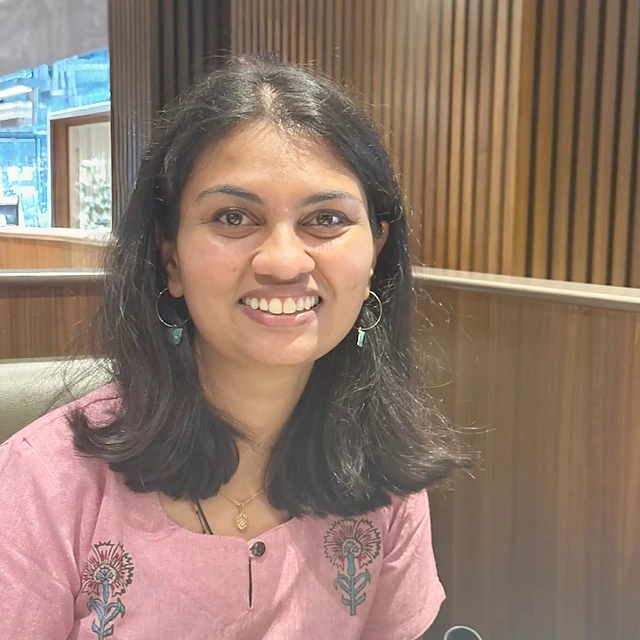
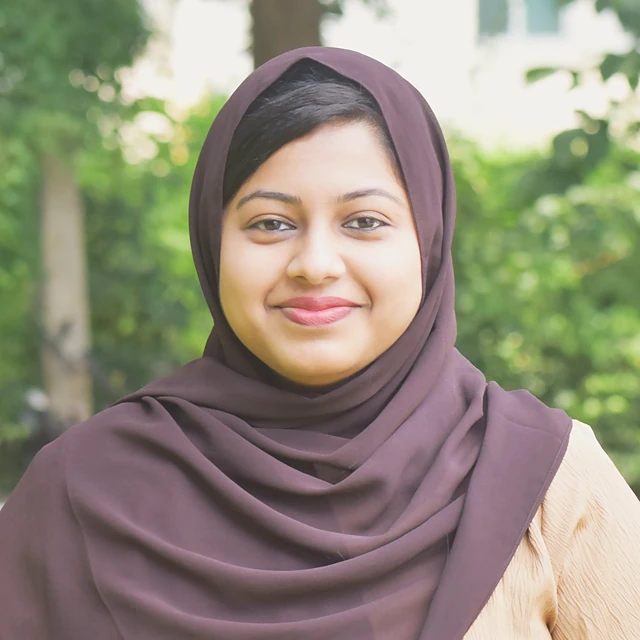
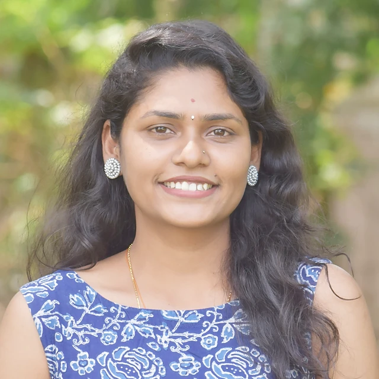
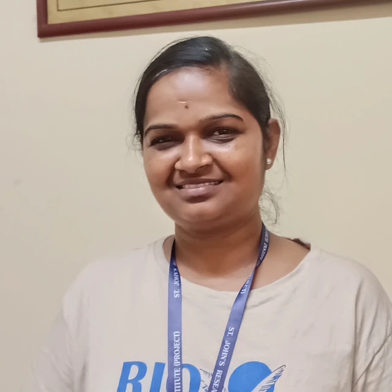
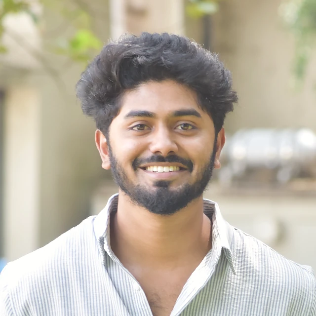

The group is headed by [Prof. Prashanth Thankachan](../index.html).

The Micronutrients Group of the Division of Nutrition at SJRI. Laboratory analysis of trace elements, iron biomarkers and isotope methods that show what fortification and supplementation do in the body.

## Current work

```{=html}
<ul class="plain-list gwork"><li><strong>Trace-element analysis</strong> – ICP-OES with microwave digestion (CEM MARS) of serum, whole blood, food and water samples, including method development, validation and quality control.</li><li><strong>Non-transferrin-bound iron</strong> – How oral iron–folic acid supplementation and iron-fortified rice change non-transferrin-bound iron in women of reproductive age.</li><li><strong>Double-fortified salt</strong> – Sensory acceptability and storage stability of salt fortified with iodine and iron.</li><li><strong>Iron absorption by stable isotopes</strong> – TIMS-based studies of iron absorption, including salt fortified with iodine and encapsulated ferric pyrophosphate (with ETH Zurich).</li><li><strong>Anaemia biomarkers</strong> – Hepcidin and other biomarkers by ELISA and the Roche platform, alongside field blood collection and biobanking.</li><li><strong>Calcium isotopes in children</strong> – Natural variability of urinary calcium isotopes as bone mineral changes with increasing dietary calcium (New York Academy of Sciences).</li></ul>
```

## Team

```{=html}
<div class="gteam"><p class="gnote">Group lead</p><div class="gteam-lead"><a class="gmini" href="../people/index.html#nikhitha-mariya-john"><figure class="pface sm"></figure><span><strong>Nikhitha Mariya John</strong><em>Project Research Scientist II (Non-Medical)</em></span></a></div><p class="gnote">Members</p><div class="gteam-grid"><a class="gmini" href="../people/index.html#nufa-akber-a"><figure class="pface sm"></figure><span><strong>Nufa Akber A</strong><em>PhD Scholar</em></span></a><a class="gmini" href="../people/index.html#divyashree-k"><figure class="pface sm"></figure><span><strong>Divyashree K</strong><em>Biochemist</em></span></a><a class="gmini" href="../people/index.html#deepa-n"><figure class="pface sm"></figure><span><strong>Deepa N</strong><em>Technical Support III (ICMR)</em></span></a><a class="gmini" href="../people/index.html#elavarasan-a"><figure class="pface sm"></figure><span><strong>Elavarasan A</strong><em>Medical Laboratory Professional</em></span></a><a class="gmini" href="../people/index.html#darshan-vd"><figure class="pface sm"></figure><span><strong>Darshan V D</strong><em>Outcome Support, PRAKASH</em></span></a></div></div>
```

```{=html}
<script>
(function(){
  var main=document.getElementById('quarto-document-content'); if(!main) return;
  var secs=[].slice.call(main.querySelectorAll(':scope > section.level2')); if(secs.length<2) return;
  var bar=document.createElement('div'); bar.className='gtabs'; bar.setAttribute('role','tablist');
  secs[0].parentNode.insertBefore(bar,secs[0]);
  function show(i,push){secs.forEach(function(s,j){s.classList.toggle('gpanel-on',j===i)});[].forEach.call(bar.children,function(b,j){b.setAttribute('aria-selected',j===i);b.classList.toggle('on',j===i)});if(push)history.replaceState(null,'','#'+secs[i].id)}
  secs.forEach(function(s,i){var h=s.querySelector(':scope > h2'); var b=document.createElement('button'); b.type='button'; b.setAttribute('role','tab'); b.textContent=h?h.textContent:('Tab '+(i+1)); b.onclick=function(){show(i,true)}; bar.appendChild(b); s.classList.add('gpanel')});
  var start=0; secs.forEach(function(s,i){if(location.hash==='#'+s.id)start=i}); show(start,false);
})();
</script>
```