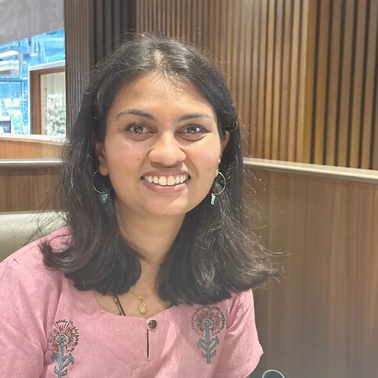
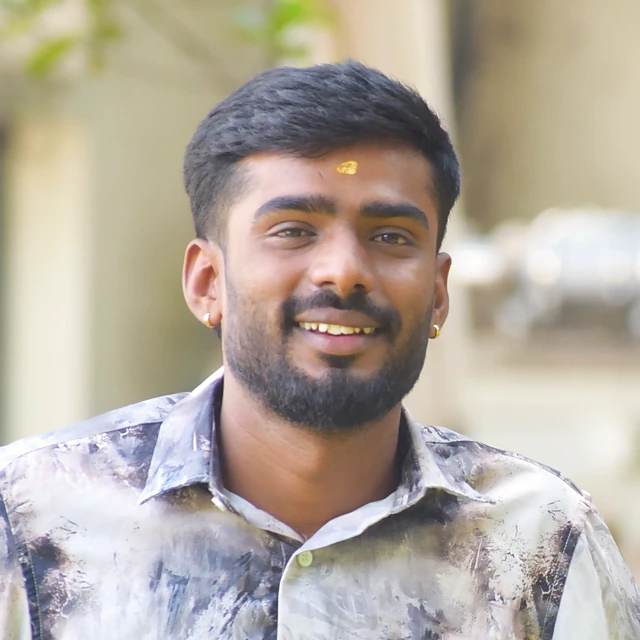
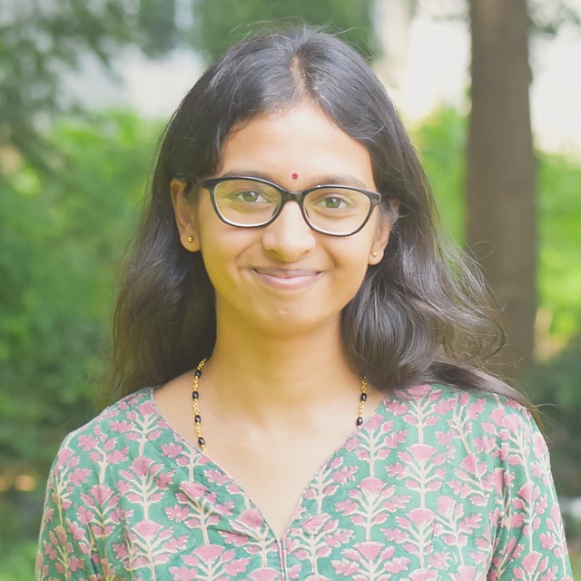
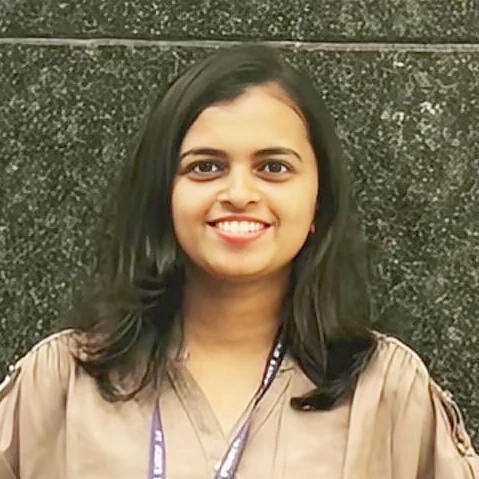
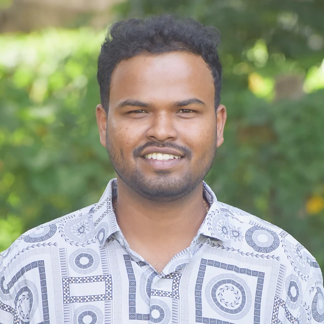
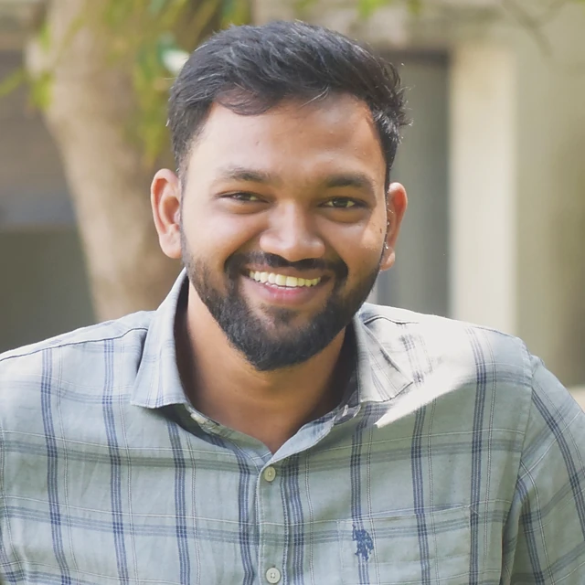

Precision-Driven Response for Anemia Control and Sustainable Health: ICMR-funded implementation research in Koppal district, Karnataka, within the Anemia Mukt Bharat 2.0 framework.

## Current work

```{=html}
<ul class="plain-list gwork"><li><strong>Implementation research</strong> – Co-designing, optimising, implementing and evaluating intervention delivery strategies for Anemia Mukt Bharat 2.0 in selected districts. ICMR, 2025–2027.</li><li><strong>Koppal field site</strong> – Blood sampling camps, field staff training, stakeholder meetings and day-to-day field coordination in Koppal district, Karnataka.</li><li><strong>Digital tracking</strong> – An individual-level anaemia tracking platform, with outcome monitoring through electronic data capture and routine data-quality checks.</li><li><strong>Behaviour change research</strong> – Qualitative work on how gender norms and social context shape anaemia-related behaviour among women of reproductive age.</li><li><strong>Policy translation</strong> – Working with national and state stakeholders to turn findings into recommendations for anaemia-control programmes.</li></ul>
```

## Team

```{=html}
<div class="gteam"><p class="gnote">Group lead</p><div class="gteam-lead"><a class="gmini" href="../people/index.html#nikhitha-mariya-john"><figure class="pface sm"></figure><span><strong>Nikhitha Mariya John</strong><em>Project Research Scientist II (Non-Medical)</em></span></a></div><p class="gnote">Members</p><div class="gteam-grid"><a class="gmini" href="../people/index.html#shivaraj-kumar-b"><figure class="pface sm"></figure><span><strong>Shivaraj Kumar B</strong><em>Field Coordinator, Koppal · Outcome Monitoring</em></span></a><a class="gmini" href="../people/index.html#kavya-n"><figure class="pface sm"></figure><span><strong>Kavya N</strong><em>Project Technical Support III</em></span></a><a class="gmini" href="../people/index.html#ria-popli"><figure class="pface sm"></figure><span><strong>Ria Popli</strong><em>PhD Scholar · Project Technical Support</em></span></a><a class="gmini" href="../people/index.html#preeti-lalasangi"><figure class="pface sm"></figure><span><strong>Preeti Lalasangi</strong><em>Technical Support III</em></span></a><a class="gmini" href="../people/index.html#rajesh-hs"><figure class="pface sm"></figure><span><strong>Rajesh H S</strong><em>Data Manager</em></span></a><a class="gmini" href="../people/index.html#chikkaswamy"><figure class="pface sm"></figure><span><strong>Chikkaswamy</strong><em>Multitasking Staff</em></span></a></div></div>
```

```{=html}
<script>
(function(){
  var main=document.getElementById('quarto-document-content'); if(!main) return;
  var secs=[].slice.call(main.querySelectorAll(':scope > section.level2')); if(secs.length<2) return;
  var bar=document.createElement('div'); bar.className='gtabs'; bar.setAttribute('role','tablist');
  secs[0].parentNode.insertBefore(bar,secs[0]);
  function show(i,push){secs.forEach(function(s,j){s.classList.toggle('gpanel-on',j===i)});[].forEach.call(bar.children,function(b,j){b.setAttribute('aria-selected',j===i);b.classList.toggle('on',j===i)});if(push)history.replaceState(null,'','#'+secs[i].id)}
  secs.forEach(function(s,i){var h=s.querySelector(':scope > h2'); var b=document.createElement('button'); b.type='button'; b.setAttribute('role','tab'); b.textContent=h?h.textContent:('Tab '+(i+1)); b.onclick=function(){show(i,true)}; bar.appendChild(b); s.classList.add('gpanel')});
  var start=0; secs.forEach(function(s,i){if(location.hash==='#'+s.id)start=i}); show(start,false);
})();
</script>
```