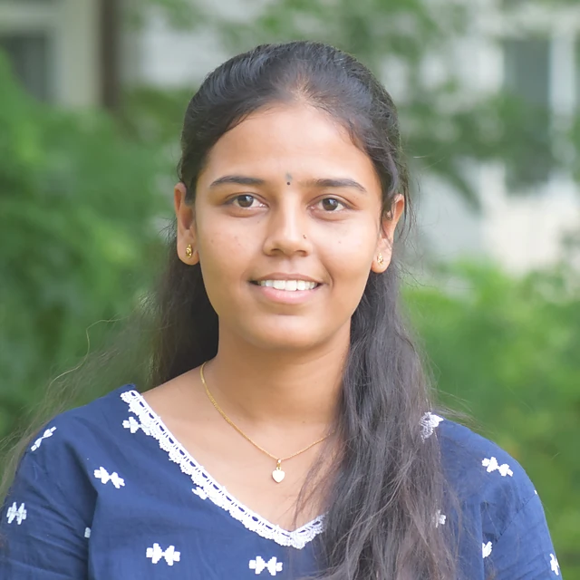

The PGIMER–BMGF learning initiative on vitamin A and D fortification programming in India, run from the Division of Nutrition.

## Current work

```{=html}
<ul class="plain-list gwork"><li><strong>Coverage, quality and adequacy</strong> – Evaluating large-scale vitamin A and D fortification of edible oil and milk in Karnataka, as part of a multicentre learning initiative.</li><li><strong>Field work and sampling</strong> – Participant recruitment, field blood collection, dietary assessment and data entry across study sites.</li><li><strong>Evidence for policy</strong> – Findings feed into fortification policy and strengthen micronutrient surveillance. Funded by the Gates Foundation and PGIMER.</li></ul>
```

## Team

```{=html}
<div class="gteam"><p class="gnote">Group lead</p><div class="gteam-lead"><a class="gmini" href="../people/index.html#chandni-halcyon-peris"><figure class="pface sm"></figure><span><strong>Chandni Halcyon Peris</strong><em>Project Coordinator</em></span></a></div><p class="gnote">Members</p><div class="gteam-grid"><a class="gmini" href="../people/index.html#chiranjeevi-k"><figure class="pface sm"></figure><span><strong>Chiranjeevi K</strong><em>Project Technical Support III</em></span></a><a class="gmini" href="../people/index.html#rachaprolu-usha"><figure class="pface sm"></figure><span><strong>Rachaprolu Usha</strong><em>Field Staff · Data Entry</em></span></a><a class="gmini" href="../people/index.html#vinod-p"><figure class="pface sm"></figure><span><strong>Vinod P</strong><em>Field Staff · Data Entry</em></span></a><a class="gmini" href="../people/index.html#suma-banakar"><figure class="pface sm"></figure><span><strong>Suma Banakar</strong><em>Field Staff · Data Entry</em></span></a></div></div>
```

```{=html}
<script>
(function(){
  var main=document.getElementById('quarto-document-content'); if(!main) return;
  var secs=[].slice.call(main.querySelectorAll(':scope > section.level2')); if(secs.length<2) return;
  var bar=document.createElement('div'); bar.className='gtabs'; bar.setAttribute('role','tablist');
  secs[0].parentNode.insertBefore(bar,secs[0]);
  function show(i,push){secs.forEach(function(s,j){s.classList.toggle('gpanel-on',j===i)});[].forEach.call(bar.children,function(b,j){b.setAttribute('aria-selected',j===i);b.classList.toggle('on',j===i)});if(push)history.replaceState(null,'','#'+secs[i].id)}
  secs.forEach(function(s,i){var h=s.querySelector(':scope > h2'); var b=document.createElement('button'); b.type='button'; b.setAttribute('role','tab'); b.textContent=h?h.textContent:('Tab '+(i+1)); b.onclick=function(){show(i,true)}; bar.appendChild(b); s.classList.add('gpanel')});
  var start=0; secs.forEach(function(s,i){if(location.hash==='#'+s.id)start=i}); show(start,false);
})();
</script>
```