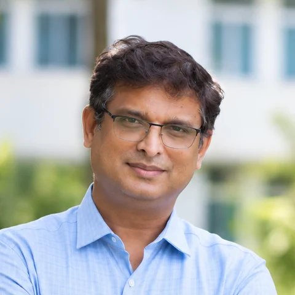
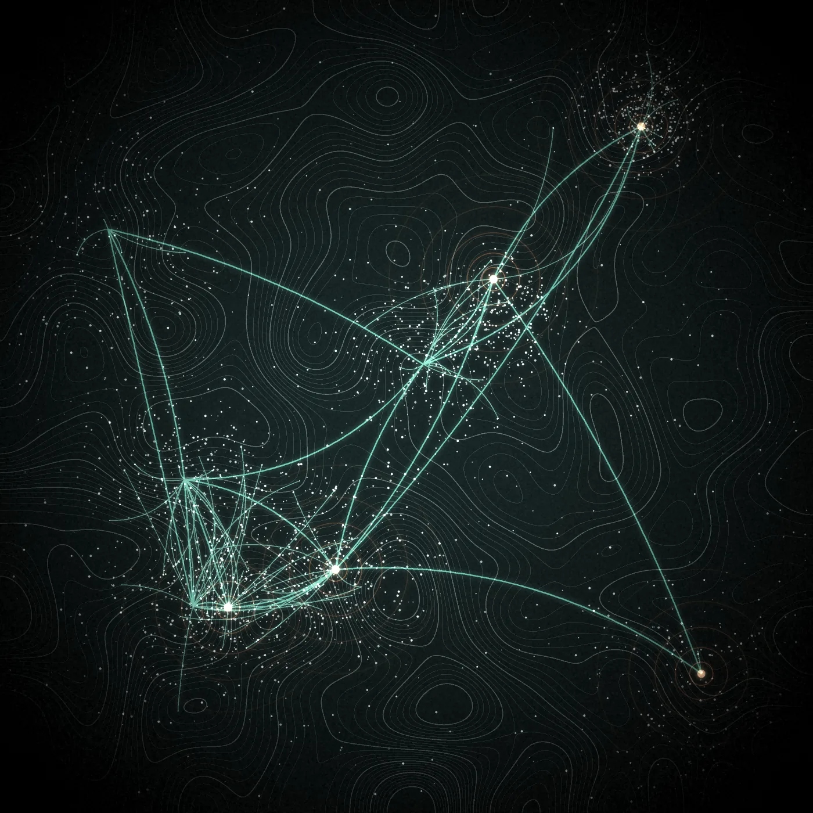
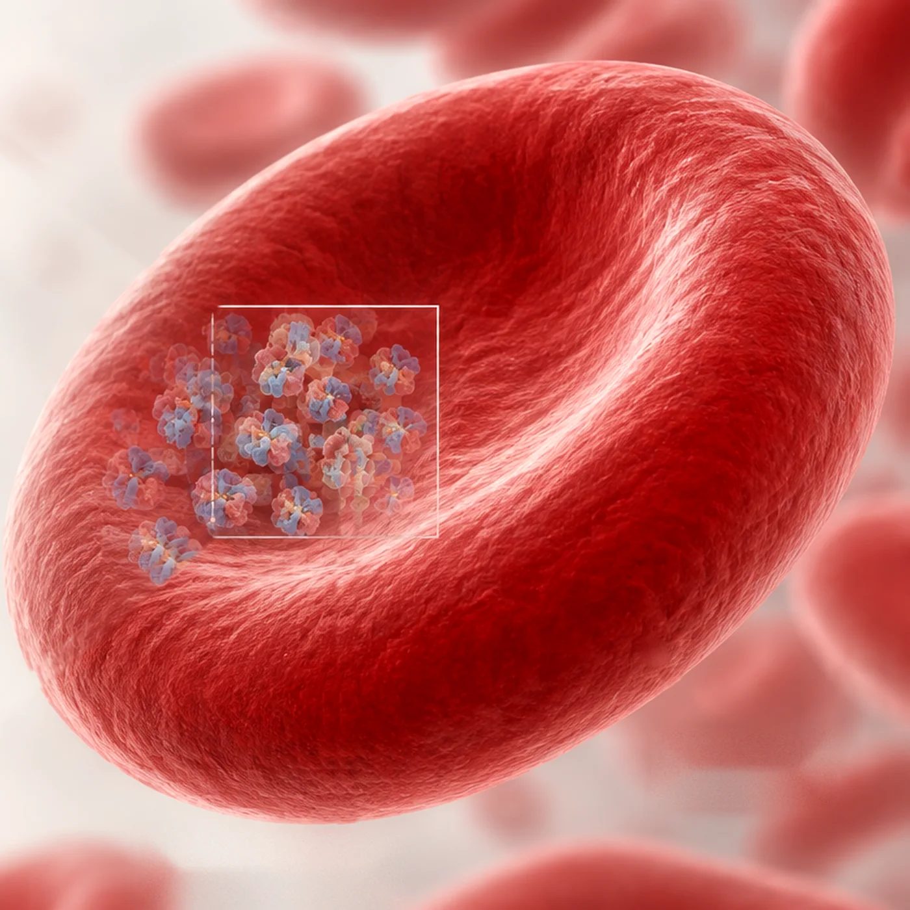
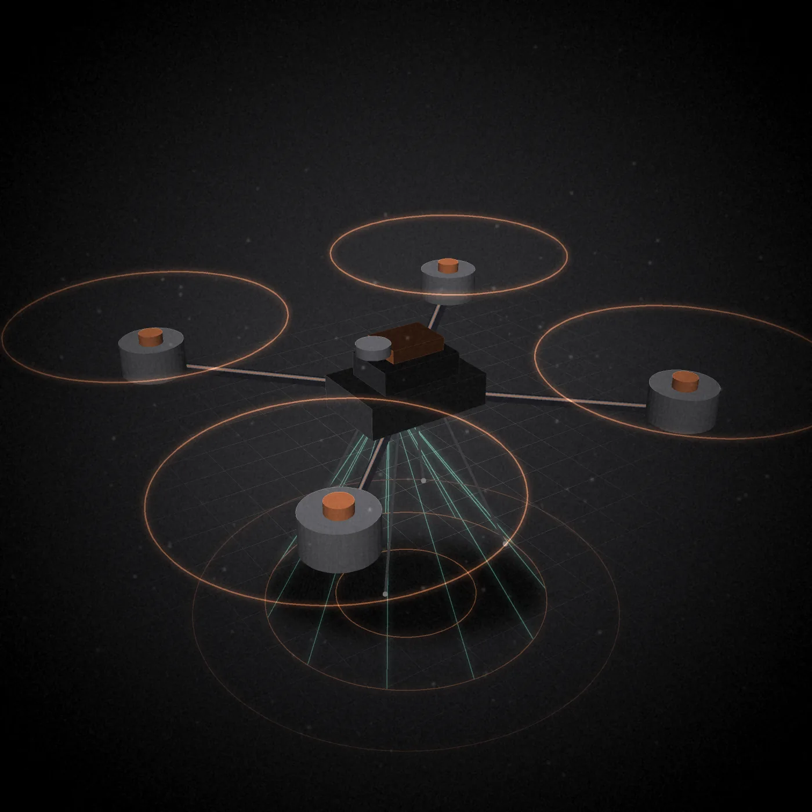
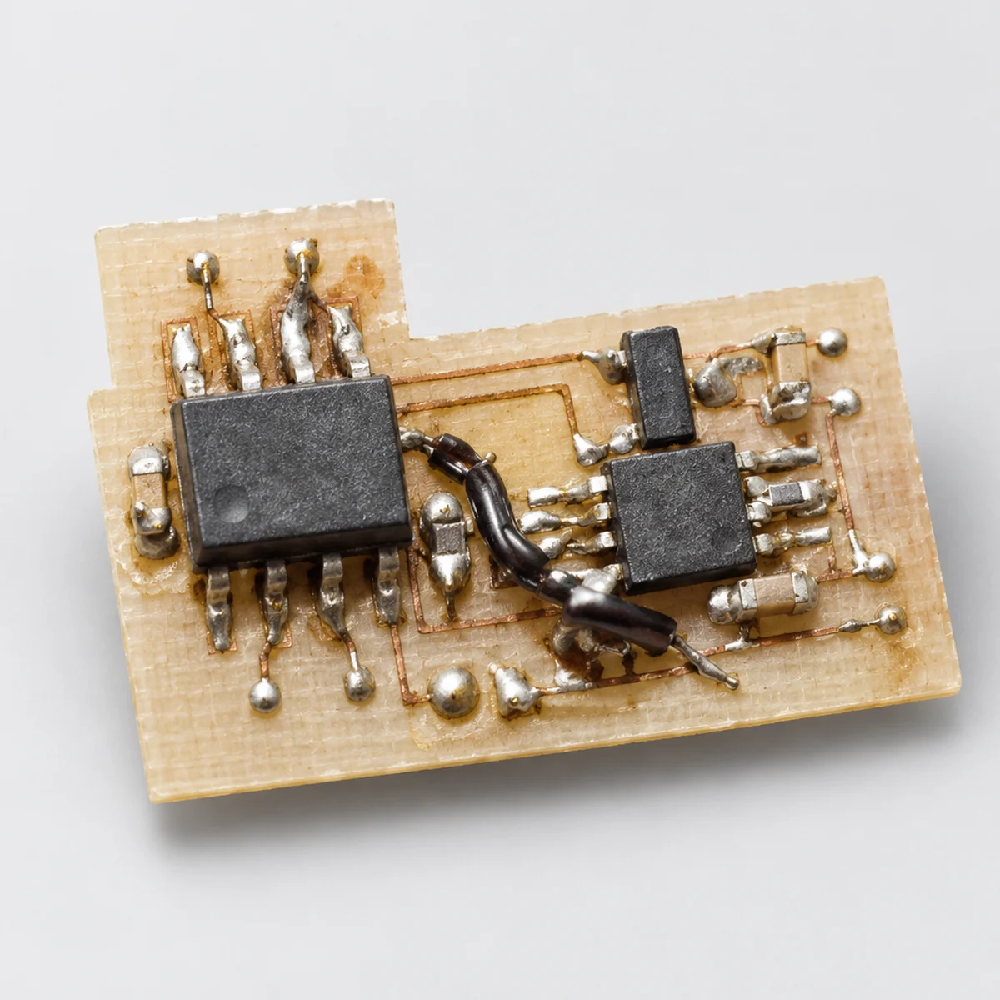
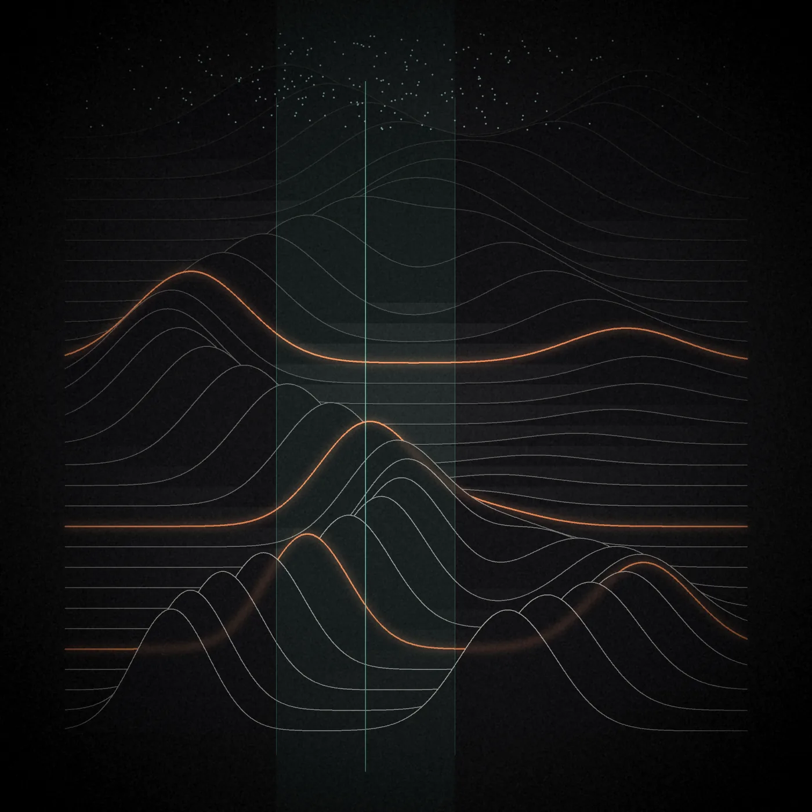

---
title: "About"
title-block-banner: false
toc: false
page-layout: full
---

::: {.homepage}

<div class="geometry-background" aria-hidden="true">
<canvas id="geometry-canvas"></canvas>
</div>

<div class="geometry-links" aria-hidden="true">
<canvas id="geometry-links"></canvas>
</div>

::: {.hero-section}

::: {.hero-copy}

<div class="professor-portrait" data-net-anchor="edge" tabindex="0" role="button" aria-label="Show portrait in colour">
  
</div>

::: {.intro-eyebrow}
Nutrition · Public Health · Translational Research
:::

# From nutrients to better lives<span class="hero-period">.</span> { .hero-title data-net-anchor="left" }

Prashanth Thankachan is Professor in the Division of
Nutrition at St. John's Research Institute, Bengaluru,
and Programme Director of ICMR CAR–MedTech.

His work spans nutritional physiology, micronutrient
research, public health and the development and
evaluation of medical technologies.

```{=html}
<ul class="hero-topics" aria-label="Research themes">
  <li><button type="button" class="net-term" id="t-micro" data-slide="0" data-net-anchor="edge" data-net-ambient="off">Micronutrients</button></li>
  <li><button type="button" class="net-term" id="t-public" data-slide="1" data-net-anchor="edge" data-net-ambient="off">Public health</button></li>
  <li><button type="button" class="net-term" id="t-anaemia" data-slide="2" data-net-anchor="edge" data-net-ambient="off">Anaemia</button></li>
  <li><button type="button" class="net-term" id="t-uav" data-slide="3" data-net-anchor="edge" data-net-ambient="off">UAV design</button></li>
  <li><button type="button" class="net-term" id="t-devices" data-slide="4" data-net-anchor="edge" data-net-ambient="off">Medical devices</button></li>
  <li><button type="button" class="net-term" id="t-models" data-slide="5" data-net-anchor="edge" data-net-ambient="off">Computational models</button></li>
</ul>
```

:::

::: {.hero-visual}

```{=html}
<div class="hero-stage-wrap" data-net-anchor="edge" data-net-inset="0.42" data-net-ambient="off">
  <div class="hero-stage" id="hero-stage">
    
    
    
    
    
    
    <div class="hs-tint"></div>
  </div>
  <div class="hero-caption" aria-live="polite">
    <span class="hc-index">01</span>
    <span class="hc-label">Micronutrients</span>
    <span class="hc-ticks"></span>
  </div>
</div>
```

:::

:::

```{=html}
<section class="work-timeline" id="work" aria-labelledby="wt-title">
  <p class="wt-eyebrow" id="wt-title">Selected work</p>
  <canvas class="wt-canvas" aria-hidden="true"></canvas>
  <ol class="wt-list">
    <li class="wt-item">
      <span class="wt-dot" aria-hidden="true"></span>
      <p class="wt-date">2006–2012</p>
      <h3>Proof in the school lunch: fortifying staple foods</h3>
      <p>In 2006, a double-blind school-lunch trial in Bangalore shows that rice fortified with iron, in grains indistinguishable from natural rice, cuts iron deficiency in children from 78% to 25% in seven months.</p>
      <p>The same school-based approach then tests wheat flour, double-fortified salt and rice with added vitamins and zinc, building the evidence base for fortifying staple foods.</p>
      <p class="wt-ref">Moretti et al., <em>Am J Clin Nutr</em> 84:822–9</p>
    </li>
    <li class="wt-item">
      <span class="wt-dot" aria-hidden="true"></span>
      <p class="wt-date">2007–2008</p>
      <h3>Finding the cause: why iron runs short</h3>
      <p>A 2007 study of 100 young women in a Bangalore settlement finds 39% anaemic and 62% iron deficient. Their diet supplies 9.5 mg of iron a day, with an estimated 2.8% of its non-haem iron absorbed, and parasites are rare, so diet is the main cause.</p>
      <p>Stable-isotope studies in 2008 show that tea cuts iron absorption by 49–67% and ascorbic acid raises it by 270–350%.</p>
      <p class="wt-ref"><em>Food Nutr Bull</em> 28(3):328–36 · <em>Am J Clin Nutr</em> 87:881–6</p>
    </li>
    <li class="wt-item">
      <span class="wt-dot" aria-hidden="true"></span>
      <p class="wt-date">2022–2026</p>
      <h3>Scale and policy: from trials to national programmes</h3>
      <p>India loses over US$12 billion of GDP a year to vitamin and mineral deficiencies. In 2022, the Government of India approves mandatory rice fortification across its food-based safety-net programmes.</p>
      <p>A 2026 perspective sets out the evidence and what comes next: wheat flour and salt where rice is not the staple, stronger quality assurance, and the long-term effects across whole populations that are still to be measured.</p>
      <p class="wt-ref"><a href="https://doi.org/10.1038/s41430-026-01761-y" target="_blank" rel="noopener">Thankachan, Swaminathan &amp; Muthayya, <em>Eur J Clin Nutr</em> 80:551–6 ↗</a></p>
    </li>
  </ol>
</section>
```

::: {.section-divider}
:::

::: {.editorial-section}

## About {data-net-anchor="left"}

Trained in medical physiology, his research has
examined micronutrient deficiencies, nutrient
bioavailability and the effectiveness of nutritional
interventions.

Alongside this work, he has pursued the development
of healthcare technologies, bringing together
clinical research, engineering and experimental
approaches to address practical healthcare needs.

:::

::: {.section-divider}
:::

::: {.editorial-section}

## Research {data-net-anchor="left"}

### Nutrition and public health {data-net-anchor="left"}

Micronutrient deficiencies, food fortification,
nutritional assessment and population-level
interventions.

[Explore research →](research/index.qmd)

### Medical technology {data-net-anchor="left"}

Development, characterisation and clinical
validation of medical devices through CAR–MedTech.

[Explore CAR–MedTech →](research/projects.qmd)

### Computational methods {data-net-anchor="left"}

Applications of data science, machine learning
and sensor-based systems in healthcare research.

[Explore projects →](research/areas.qmd)

:::

::: {.section-divider}
:::

::: {.editorial-section}

## Selected work {data-net-anchor="left"}

A selection of publications, ongoing research
projects and collaborative work.

[View publications →](publications/index.qmd)

:::

:::

<script>
(function () {
  var wrap = document.querySelector(".work-timeline");
  if (!wrap) return;
  var cv = wrap.querySelector(".wt-canvas"), cx = cv.getContext("2d");
  var dots = [].slice.call(wrap.querySelectorAll(".wt-dot"));
  var COL = [[88, 145, 131], [180, 105, 67], [88, 145, 131]];
  var W = 0, H = 0, pts = [], cur = null, held = -1, dir = 1, nextFrom = 0, last = 0, glow = [0, 0, 0];
  var rm = window.matchMedia("(prefers-reduced-motion: reduce)");
  var ez = function (x) { return x * x * (3 - 2 * x); };

  function layout() {
    var wr = wrap.getBoundingClientRect(), dpr = Math.min(window.devicePixelRatio || 1, 2);
    var first = dots[0].getBoundingClientRect();
    W = wr.width; H = 90;
    cv.style.width = W + "px"; cv.style.height = H + "px";
    cv.width = Math.round(W * dpr); cv.height = Math.round(H * dpr);
    cx.setTransform(dpr, 0, 0, dpr, 0, 0);
    cv.style.top = (first.top - wr.top + first.height / 2 - H + 10) + "px";
    pts = dots.map(function (d) { var r = d.getBoundingClientRect(); return { x: r.left - wr.left + r.width / 2, y: H - 10 }; });
  }

  function newArc() {
    var from = nextFrom, to = from + dir;
    if (to > 2 || to < 0) { dir = -dir; to = from + dir; }
    nextFrom = to;
    return { from: from, to: to, head: 0, tail: 0, t: 0, hold: 1.6, wide: 0.55, wt: 0.55, tick: 0, col: COL[to] };
  }

  function step(dt) {
    if (!cur || cur.done) { cur = newArc(); held = cur.from; }
    var A = cur;
    if (A.head < 1) A.head = Math.min(1, A.head + dt / 1.2);
    else {
      A.t += dt;
      if (A.t > A.hold * 0.5 && !A.changed) { A.changed = true; A.wt = A.wide > 0.8 ? 0.4 : 1; }
      if (A.t > A.hold + 0.8) A.tail = Math.min(1, A.tail + dt / 1.2);
      if (A.tail >= 1) { A.done = true; held = A.to; }
    }
    A.wide += (A.wt - A.wide) * Math.min(1, dt * 2.2);
    var tg = [0, 0, 0];
    if (held >= 0) tg[held] = 1;
    tg[A.from] = 1 - ez(A.tail);
    tg[A.to] = Math.max(tg[A.to], ez(Math.max(0, (A.head - 0.85) / 0.15)));
    for (var i = 0; i < 3; i++) glow[i] += (tg[i] - glow[i]) * Math.min(1, dt * 5);
  }

  function draw() {
    cx.clearRect(0, 0, W, H);
    if (cur && pts.length === 3) {
      var A = cur, p0 = pts[A.from], p1 = pts[A.to], c = A.col;
      var span = p1.x - p0.x, bulge = Math.min(48, Math.abs(span) * 0.16) * A.wide + 6;
      var cy1 = p0.y - bulge * 4 / 3, hp = ez(A.head), tp = ez(A.tail);
      if (hp - tp > 0.001) {
        cx.strokeStyle = "rgba(" + c[0] + "," + c[1] + "," + c[2] + ",0.5)";
        cx.lineWidth = 1.1; cx.lineCap = "round"; cx.beginPath();
        for (var s = 0; s <= 48; s++) {
          var t = tp + (hp - tp) * s / 48, u = 1 - t;
          var x = u * u * u * p0.x + 3 * u * u * t * (p0.x + span * 0.08) + 3 * u * t * t * (p1.x - span * 0.08) + t * t * t * p1.x;
          var y = (u * u * u + t * t * t) * p0.y + 3 * u * t * (u + t) * cy1;
          if (s === 0) cx.moveTo(x, y); else cx.lineTo(x, y);
        }
        cx.stroke();
      }
    }
    for (var i = 0; i < pts.length; i++) {
      var g = glow[i]; if (g < 0.02) continue;
      var cc = COL[i];
      cx.save();
      cx.shadowColor = "rgba(" + cc[0] + "," + cc[1] + "," + cc[2] + ",0.85)"; cx.shadowBlur = 14 * g;
      cx.fillStyle = "rgba(" + cc[0] + "," + cc[1] + "," + cc[2] + "," + Math.min(1, 0.95 * g) + ")";
      cx.beginPath(); cx.arc(pts[i].x, pts[i].y, 6.5 + g * 1.5, 0, 6.2832); cx.fill();
      cx.restore();
    }
  }

  function onScreen() { var r = wrap.getBoundingClientRect(); return r.bottom > 0 && r.top < innerHeight; }
  function loop(ts) {
    var dt = Math.min(0.05, (ts - last) / 1000 || 0.016); last = ts;
    if (onScreen() && W > 700) { step(dt); draw(); }
    requestAnimationFrame(loop);
  }
  layout();
  addEventListener("resize", layout); addEventListener("load", layout);
  if (window.ResizeObserver) new ResizeObserver(layout).observe(wrap);
  if (rm.matches) { glow[0] = 1; draw(); } else requestAnimationFrame(function (t) { last = t; loop(t); });
})();
</script>
<script src="geometry.js"></script>
<script src="hero-stage.js"></script>
<script>
(function () {
  var p = document.querySelector(".professor-portrait");
  if (!p) return;
  p.addEventListener("click", function () { p.classList.toggle("is-color"); });
  p.addEventListener("keydown", function (e) {
    if (e.key === "Enter" || e.key === " ") { e.preventDefault(); p.classList.toggle("is-color"); }
  });
})();
</script>
