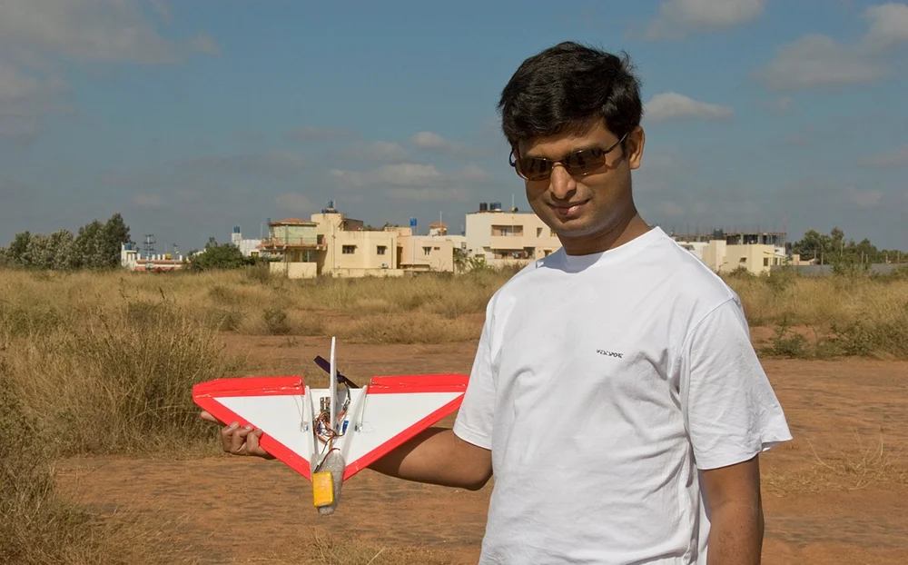
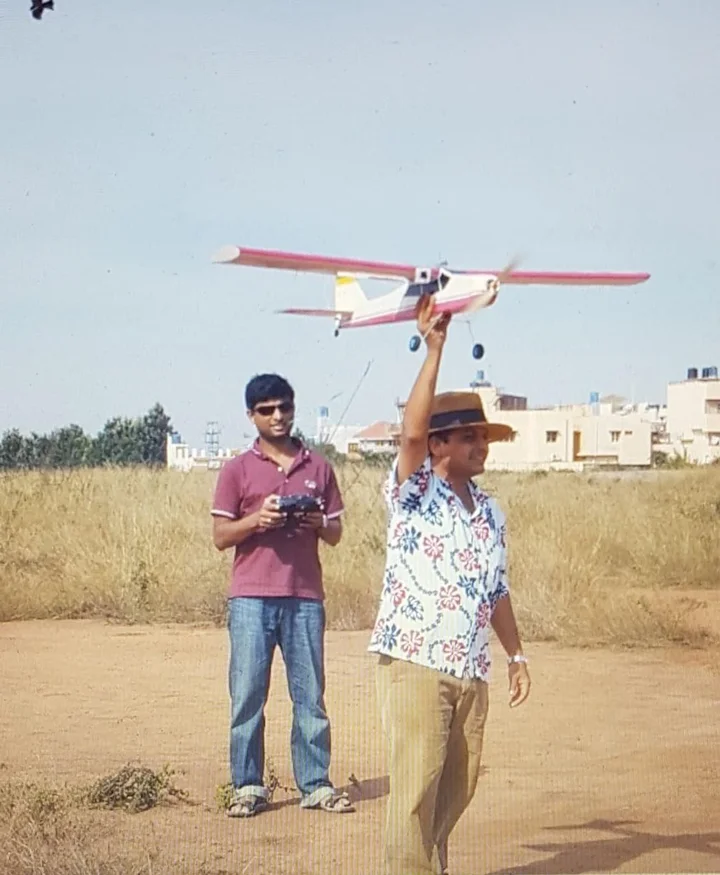
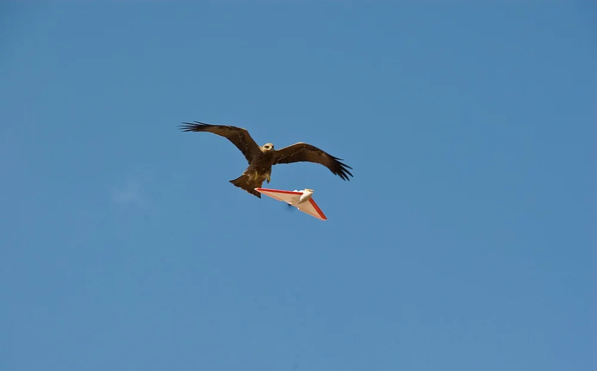
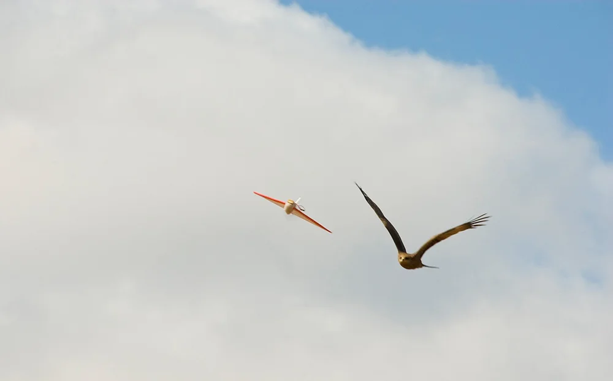

Beyond nutrition and healthcare technology.

## Aviation and unmanned aerial systems

```{=html}
<div class="uas">
  <p class="uas-lead">Prof. Thankachan has been an aeromodeller since the early 2000s. He is self-taught, with a working grasp of aerodynamics, avionics and aviation regulation, and holds a DGCA remote pilot certificate. He has flown radio-controlled and unmanned aircraft for both recreation and professional work.</p>
  <p>In 2007 he built an open-source autopilot from the circuit board up and flew it as a fully autonomous navigation system. He went on to demonstrate several autonomous flights for research at IISc.</p>

  <div class="uas-gallery">
    <div class="uas-row" style="--h:300px">
      <figure style="--ar:1.607"></figure>
      <figure style="--ar:0.823"></figure>
    </div>
    <div class="uas-row" style="--h:210px">
      <figure style="--ar:1.607"></figure>
      <figure style="--ar:1.607"></figure>
    </div>
    <p class="uas-credit">An early autonomous flying wing with camera. Photographs: Abhay Pawar.</p>
  </div>

  <div class="uas-skills">
    <h3>UAS operations and flight safety</h3>
    <ul>
      <li><strong>Licensed remote pilot.</strong> DGCA-certified remote pilot in India, for legal and safe civil and commercial drone operations.</li>
      <li><strong>Mission planning.</strong> Airspace categories from the Digital Sky maps, pre-flight checks, risk assessment and safe flight profiles.</li>
      <li><strong>Telemetry and data analysis.</strong> Live flight telemetry, battery diagnostics from single-cell to multi-cell packs, and tracing connectivity and sensor faults.</li>
    </ul>
    <h3>Aeromodelling and aerospace engineering</h3>
    <ul>
      <li><strong>Design and fabrication.</strong> Designs, builds, modifies and balances fixed-wing and rotary aircraft in balsa, foam, carbon fibre and composites.</li>
      <li><strong>Systems integration and electronics.</strong> Installs, configures and tunes autopilots, flight controllers, speed controllers (ESCs), power distribution boards and receiver and transmitter links.</li>
      <li><strong>FPV (first-person view).</strong> Sets up and tunes FPV cameras, video transmitters and low-latency radio links (ELRS, Crossfire) for micro, whoop and long-endurance platforms.</li>
    </ul>
    <h3>Aviation systems and sensors</h3>
    <ul>
      <li><strong>Hardware-in-the-loop work.</strong> Time-of-flight (ToF) sensors, odometry modules and other micro-sensors for positional and environmental telemetry.</li>
      <li><strong>Flight simulation.</strong> High-fidelity simulators to sharpen manual piloting, test aerodynamics and model aircraft behaviour in different atmospheric conditions.</li>
      <li><strong>Regulatory compliance.</strong> Aviation law, airspace restrictions, no-fly zones and maintenance logging.</li>
    </ul>
  </div>
</div>
```
