Prof. Prashanth Thankachan leads a multidisciplinary group at St John’s Research Institute. Engineers, data scientists, laboratory scientists, public health researchers and field teams work in three groups, with PRAKASH and the Vitamin A &amp; D study running within the Micronutrients group. He also supervises two PhD scholars, affiliated to Manipal Academy of Higher Education (MAHE).

```{=html}
<div class="people-page">
<section class="pgroup" id="g1"><header class="pgroup-head"><span class="eyebrow">01 · Division of Nutrition</span><h2>Micronutrients</h2><p>The Micronutrients Group of the Division of Nutrition at SJRI, headed by Prof. Prashanth Thankachan. Trace-element and micronutrient assays, iron biomarkers and laboratory analysis. It also runs the PRAKASH anaemia study and the Vitamin A &amp; D fortification study, listed below.</p></header>
<div class="plead-strip"><article id="nikhitha-mariya-john" class="pcard lead" tabindex="0"><figure class="pface v1">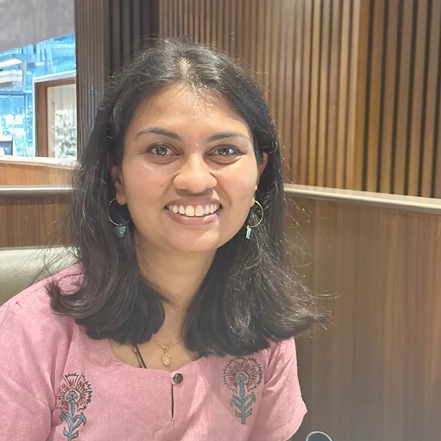</figure><div class="ptext"><span class="ptag">Group lead</span><h3>Nikhitha Mariya John</h3><p class="prole">Project Research Scientist II (Non-Medical)</p><p class="pbio">Ph.D. in Biomedical Sciences (CMC Vellore, 2025), with postdoctoral work on iron metabolism in pregnancy and a DAAD fellowship at Heidelberg. Leads study implementation at the Koppal site for PRAKASH, coordinating field teams, blood sampling camps, stakeholder meetings and staff training, and turning findings into recommendations for anaemia-control programmes. Also supports the double-fortified salt and non-transferrin-bound iron studies in the Division of Nutrition.</p><details class="pmore"><summary>Profile and publications</summary><div class="pmore-body"><h4>Education</h4><ul><li>Ph.D. Biomedical Sciences, 2025 – Christian Medical College, Vellore</li><li>M.Tech. Biotechnology, 2018 – MANIT Bhopal</li><li>B.Tech. Biotechnology, 2016 – VIT, Vellore</li></ul><h4>Positions</h4><ul><li>Project Research Scientist II (ICMR-PRAKASH), SJRI, 2026–present</li><li>Postdoctoral Fellow, Biochemistry, CMC Vellore, 2024–2026</li><li>Visiting Research Fellow (DAAD), Heidelberg University Hospital, 2023</li><li>Young Scientist Fellow (DHR), CMC Vellore, 2021–2023</li></ul><h4>Research interests</h4><p>Maternal and child nutrition, anaemia and iron deficiency, iron metabolism, placental biology and nutrient transfer, micronutrient deficiencies, and inflammation in maternal health. Interested in combining clinical and community-based research, randomised trials, biomarker analysis and implementation research.</p><h4>Publications</h4><ul><li>John NM et al. Daily oral iron supplementation produced greater improvements in hematological parameters than alternate day doses – a pilot double-blind randomized control trial in iron-deficient young women. Clinical Nutrition, 2026. <a href="https://doi.org/10.1016/j.clnu.2025.11.005" target="_blank" rel="noopener">DOI</a></li><li>John NM, Jacob M. Reply to “Comments on daily oral iron supplementation…”. Clinical Nutrition, 2026. <a href="https://doi.org/10.1016/j.clnu.2026.106642" target="_blank" rel="noopener">DOI</a></li><li>Ramasamy J et al. The presence of a H. pylori infection blunted the upregulation of iron-related duodenal proteins in response to anemia. J Nutr Biochem, 2025. <a href="https://doi.org/10.1016/j.jnutbio.2025.110048" target="_blank" rel="noopener">DOI</a></li><li>Sinha AP and PDA Collaborators. PRAYAS: Individual Patient Data Meta-analysis database for pooled research and analysis for yielding anemia-free solutions in India. Frontiers in Public Health, 2025. <a href="https://doi.org/10.3389/fpubh.2025.1696787" target="_blank" rel="noopener">DOI</a></li><li>John NM et al. Gestational diabetes mellitus was associated with dysregulation in maternal and placental iron homeostasis and lowered fetal iron status. Am J Hematol, 2025 (abstract).</li><li>John NM et al. Maternal iron deficiency in early pregnancy modulated placental iron homeostasis, possibly compromising fetal iron status. Am J Hematol, 2025 (abstract).</li><li>John NM et al. Effect of systemic inflammation in mice on maternal, placental, and fetal iron homeostasis. Am J Hematol, 2025 (abstract).</li><li>James JV et al. Insulin resistance and adipose tissue inflammation induced by a high-fat diet are attenuated in the absence of hepcidin. J Nutr Biochem, 2023. <a href="https://doi.org/10.1016/j.jnutbio.2022.109175" target="_blank" rel="noopener">DOI</a></li></ul></div></details></div></article></div>
<div class="pgrid"><article id="nufa-akber-a" class="pcard" tabindex="0"><figure class="pface v2">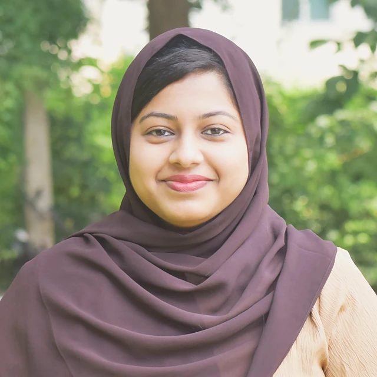</figure><div class="ptext"><h3>Nufa Akber A</h3><p class="prole">PhD Scholar</p><p class="pbio">PhD scholar at SJRI (MAHE) after four years as a nutritionist. Her thesis evaluates non-transferrin-bound iron in response to iron–folic acid supplementation and iron-fortified rice in women of reproductive age.</p><p class="psup"><span>PhD supervisor</span> Prof. Prashanth Thankachan</p><p class="pbeyond"><span>Beyond work</span> Happiest experimenting in the kitchen, singing along to music and discovering new places.</p><details class="pmore"><summary>Profile and publications</summary><div class="pmore-body"><h4>Education</h4><ul><li>Ph.D. Nutrition (ongoing, since 2026) – MAHE, Manipal, with SJRI as research centre</li><li>M.Sc. Clinical Nutrition and Dietetics, 2020 – St. Teresa’s College, Ernakulam</li><li>B.Sc. Home Science, 2015 – St. Teresa’s College, Ernakulam</li></ul><h4>Research interests</h4><p>Clinical and public health nutrition, iron metabolism and homeostasis, non-transferrin-bound iron, iron bioavailability and absorption, iron–folic acid supplementation, food fortification, randomised controlled trials.</p></div></details></div></article><article id="divyashree-k" class="pcard" tabindex="0"><figure class="pface v3">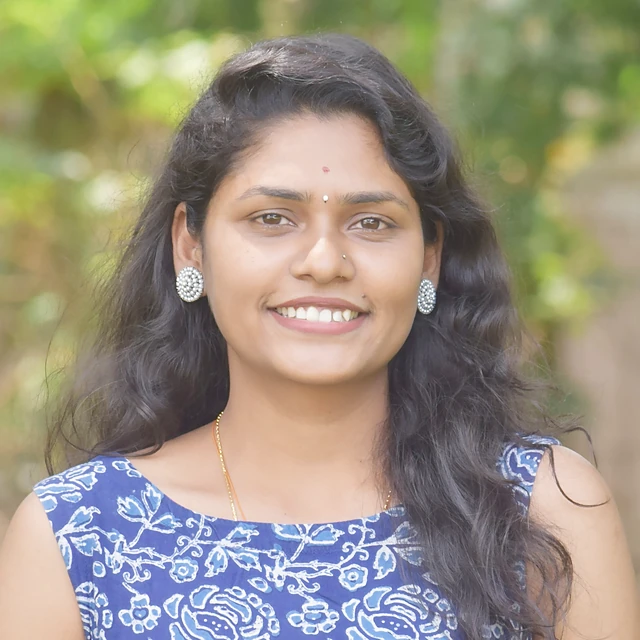</figure><div class="ptext"><h3>Divyashree K</h3><p class="prole">Biochemist</p><p class="pbio">Trace-element analysis of blood, food and water samples by ICP-OES, with microwave digestion, method validation and quality control. Works on the BMGF Sensory Stability Project and supports field studies.</p><details class="pmore"><summary>Profile and publications</summary><div class="pmore-body"><h4>Education</h4><ul><li>M.Sc. Biochemistry, 2020 – Kuvempu University</li><li>B.Sc. Biotechnology, 2018 – Kuvempu University</li></ul><h4>Positions</h4><ul><li>Biochemist, Department of Nutrition, SJRI, 2025–present</li><li>Technical Officer (R&amp;D), Hitech Pharma, 2022–2023</li><li>Laboratory Technician, Sprint Diagnostics, 2021–2022</li></ul><h4>Research interests</h4><p>Trace-element analysis of biological, food and water samples, analytical method development and validation, isotopic analysis (TIMS), ELISA, biobanking, probiotic fermentation, nanoparticle synthesis.</p><h4>Earlier research</h4><ul><li>Green synthesis of silver nanoparticles from bamboo shoot extract; antifungal efficacy of copper oxychloride-conjugated silver nanoparticles; antioxidant activity of Solanum nigrum and Tamarindus indica leaves</li></ul></div></details></div></article><article id="deepa-n" class="pcard" tabindex="0"><figure class="pface v4">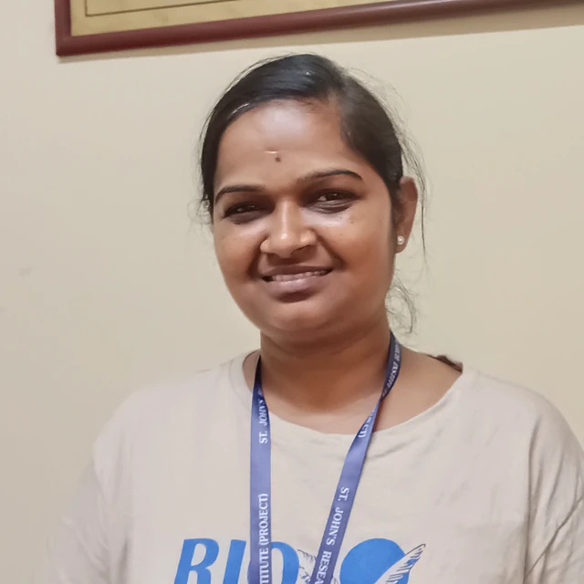</figure><div class="ptext"><h3>Deepa N</h3><p class="prole">Technical Support III (ICMR)</p><p class="pbio">B.Sc. MLT with 14 years in the Division of Nutrition. Mass spectrometry, phlebotomy, ELISA and laboratory instruments; interests in anaemia and iron metabolism.</p><details class="pmore"><summary>Profile and publications</summary><div class="pmore-body"><h4>Education</h4><ul><li>B.Sc. Medical Laboratory Technology</li></ul><h4>Research interests</h4><p>Anaemia, iron deficiency, iron metabolism and micronutrient deficiencies. Instruments: TIMS, Roche, CEM-MARS, chromatography, ELISA, Beckman Coulter and Horiba. 14 years at the Division of Nutrition, SJRI.</p></div></details></div></article><article id="elavarasan-a" class="pcard" tabindex="0"><figure class="pface v0">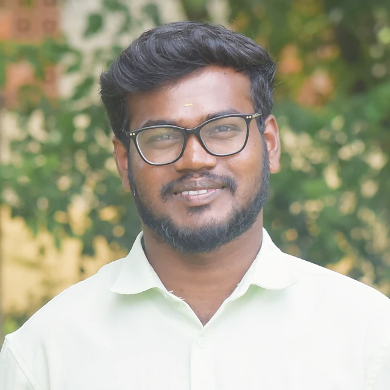</figure><div class="ptext"><h3>Elavarasan A</h3><p class="prole">Medical Laboratory Professional</p><p class="pbio">B.Sc. MLT with 2.5 years in clinical diagnostics and research. Roche analysers, haematology, ELISA and micronutrient assays, plus sample collection and quality control.</p><p class="pbeyond"><span>Beyond work</span> Dances, plays games, reads and keeps a garden.</p><details class="pmore"><summary>Profile and publications</summary><div class="pmore-body"><h4>Education</h4><ul><li>B.Sc. Medical Laboratory Technology</li></ul><h4>Research interests</h4><p>Clinical diagnostics and research: Roche Cobas C311 and e411 analysers, haematology analysers, ELISA, micronutrient assays, phlebotomy, quality control, equipment maintenance and laboratory safety.</p></div></details></div></article><article id="darshan-vd" class="pcard" tabindex="0"><figure class="pface v1">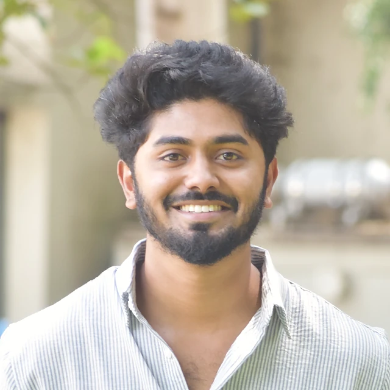</figure><div class="ptext"><h3>Darshan V D</h3><p class="prole">Outcome Support, PRAKASH</p><p class="pbio">M.Sc. Biotechnology. Trace-metal analysis and anaemia biomarker work with ICP-OES, HPLC and ELISA, supporting outcome measurement for the PRAKASH study in Koppal.</p><p class="pbeyond"><span>Beyond work</span> Into sports, the gym and biking.</p><details class="pmore"><summary>Profile and publications</summary><div class="pmore-body"><h4>Education</h4><ul><li>M.Sc. Biotechnology</li></ul><h4>Research interests</h4><p>Bioanalytical instrumentation and analytical techniques: ICP-OES, HPLC, ELISA and the Roche platform; trace-metal analysis and anaemia biomarker studies.</p></div></details></div></article></div>
<section class="pgroup psub" id="g4"><header class="pgroup-head"><span class="eyebrow">Within Micronutrients · ICMR · Koppal</span><h3>PRAKASH</h3><p>Precision-Driven Response for Anemia Control and Sustainable Health. Implementation research in Koppal district, Karnataka, under Anemia Mukt Bharat 2.0. Led by Nikhitha Mariya John.</p></header>
<div class="pgrid"><article id="shivaraj-kumar-b" class="pcard" tabindex="0"><figure class="pface v3">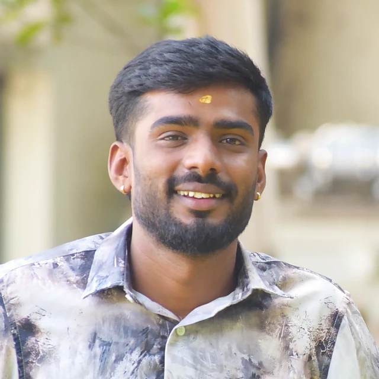</figure><div class="ptext"><h3>Shivaraj Kumar B</h3><p class="prole">Field Coordinator, Koppal · Outcome Monitoring</p><p class="pbio">Coordinates the field work in Koppal for the PRAKASH study. B.Pharm with an MBA in Pharma and Biotechnology; experienced in participant recruitment, EDC data collection, validation and quality checks. Previously Project Assistant on the NYAS project (TIMS, haematology analyser, sample processing).</p><details class="pmore"><summary>Profile and publications</summary><div class="pmore-body"><h4>Education</h4><ul><li>B.Pharm</li><li>MBA in Pharma and Biotechnology</li></ul><h4>Positions</h4><ul><li>Outcome Monitoring, ICMR PRAKASH</li><li>Project Assistant, NYAS project (TIMS, haematology analyser, blood sample processing and storage)</li></ul><h4>Research interests</h4><p>Clinical research and clinical trial management: trial operations, data quality and study coordination.</p></div></details></div></article><article id="kavya-n" class="pcard" tabindex="0"><figure class="pface v4"></figure><div class="ptext"><h3>Kavya N</h3><p class="prole">Project Technical Support III</p><p class="pbio">B.Pharm. Works on implementation research for Anemia Mukt Bharat 2.0: participant recruitment, field data collection and study documentation.</p><details class="pmore"><summary>Profile and publications</summary><div class="pmore-body"><h4>Education</h4><ul><li>B.Pharm</li></ul><h4>Research interests</h4><p>Clinical research, public health research, implementation science, pharmacovigilance and research project management.</p><h4>Publications</h4><ul><li>Sida acuta Burm. f.: A Comprehensive Review.</li></ul></div></details></div></article><article id="ria-popli" class="pcard" tabindex="0"><figure class="pface v0">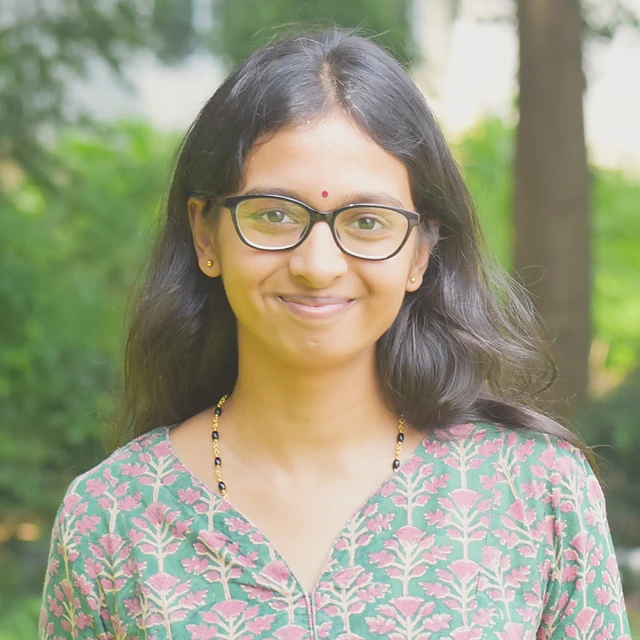</figure><div class="ptext"><h3>Ria Popli</h3><p class="prole">PhD Scholar · Project Technical Support</p><p class="pbio">PhD scholar working on women’s health and behaviour change. Her doctoral work covers anaemia in women of reproductive age and social and behaviour change communication, using qualitative methods.</p><p class="psup"><span>PhD supervisor</span> Dr. Manjulika Vaz, Associate Professor, Division of Health and Humanities</p><details class="pmore"><summary>Profile and publications</summary><div class="pmore-body"><h4>Education</h4><ul><li>Ph.D. (ongoing, since 2024) – St. John’s Research Institute</li><li>M.Sc. Psychology (Health and Well-being), 2023 – Christ University</li><li>B.A. (Hons) Psychology, 2021 – Jesus and Mary College, University of Delhi</li></ul><h4>Positions</h4><ul><li>Clinical Research Associate, Indian Institute of Science</li><li>Internships: NIMHANS, SJRI, Population Council, International Center for Research on Women</li></ul><h4>Research interests</h4><p>Women’s health, health psychology, public health, and the social and cultural determinants of health. Doctoral work: anaemia among women of reproductive age and social and behaviour change communication. Earlier work on menopause, sleep and education.</p></div></details></div></article><article id="preeti-lalasangi" class="pcard" tabindex="0"><figure class="pface v1">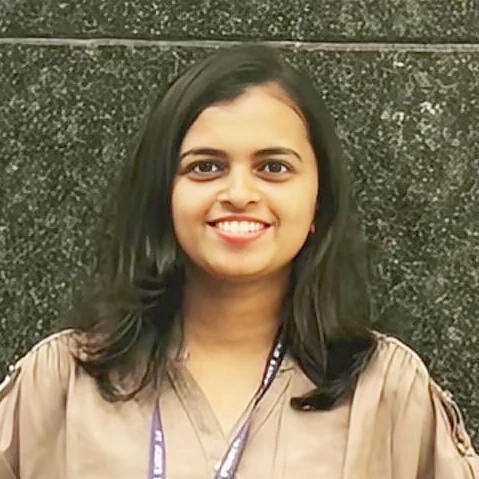</figure><div class="ptext"><h3>Preeti Lalasangi</h3><p class="prole">Technical Support III</p><p class="pbio">BSc, MPH. Public health researcher with experience in maternal and child health, medical statistics, immunisation monitoring and cancer awareness.</p><details class="pmore"><summary>Profile and publications</summary><div class="pmore-body"><h4>Education</h4><ul><li>MPH Public Health, 2023 – KLE JN Medical College, Belagavi</li><li>B.Sc., 2021 – Akkamahadevi University, Vijayapura</li></ul><h4>Positions</h4><ul><li>Technical Support III, ICMR-PRAKASH, 2025–present</li><li>Technical Support III, ICMR-CAR MEDTECH, 2024–2025</li><li>Research Assistant, Fogarty/NIH cancer research, 2024</li></ul><h4>Research interests</h4><p>Public and community health, epidemiology of communicable and non-communicable diseases, maternal and child health, cancer prevention, monitoring and evaluation, nutrition.</p></div></details></div></article><article id="rajesh-hs" class="pcard" tabindex="0"><figure class="pface v2">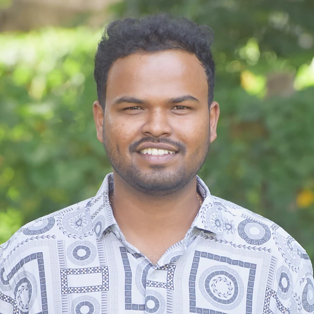</figure><div class="ptext"><h3>Rajesh H S</h3><p class="prole">Data Manager</p><p class="pbio">Manages research data, field operations and project databases for the PRAKASH anaemia study in Koppal district.</p><details class="pmore"><summary>Profile and publications</summary><div class="pmore-body"><h4>Education</h4><ul><li>B.Com., Himalayan University</li></ul><h4>Positions</h4><ul><li>Data Manager, SJRI (PRAKASH anaemia study, Koppal)</li><li>Data Entry Operator, SJRI, 2021–2023 and 2024–2025</li><li>Lab Assistant, Christ University, 2023–2024</li><li>Data Entry Operator, Rainbow Children’s Hospital, 2021</li></ul></div></details></div></article><article id="chikkaswamy" class="pcard" tabindex="0"><figure class="pface v3">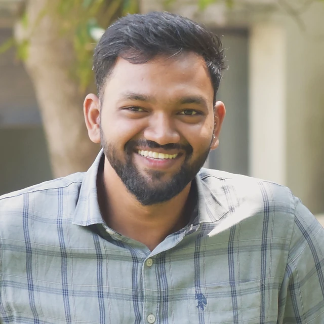</figure><div class="ptext"><h3>Chikkaswamy</h3><p class="prole">Multitasking Staff</p><p class="pbio">Data entry, data collection and field coordination support for the PRAKASH team.</p></div></article><article id="thangapandi-j" class="pcard" tabindex="0"><figure class="pface v2">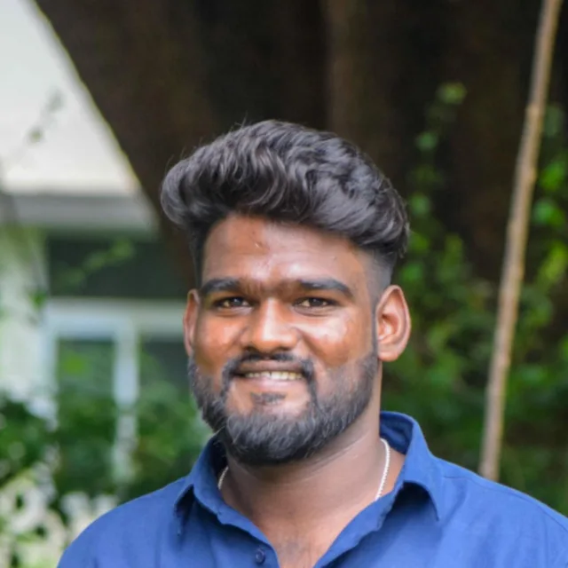</figure><div class="ptext"><h3>Thangapandi J</h3><p class="prole">Project Technical Support III · Data Outcome Monitoring</p><p class="pbio">M.Pharm in Pharmacology. Clinical research professional with experience in medical-device studies and field-based outcome monitoring: study documentation, data collection and review, source data verification and electronic data capture for ICMR-PRAKASH.</p><details class="pmore"><summary>Profile and publications</summary><div class="pmore-body"><h4>Education</h4><ul><li>M.Pharm Pharmacology, 2025 – Hillside College of Pharmacy</li><li>B.Pharm, 2023 – The Oxford College of Pharmacy</li></ul><h4>Positions</h4><ul><li>Project Technical Support III, ICMR-PRAKASH, SJRI</li><li>Project Technical Support II, ICMR-CAR MEDTECH, SJRI, Aug 2024–Mar 2026</li><li>Intern, Srushti Pharmaceuticals, 2023</li></ul><h4>Key responsibilities</h4><ul><li>Household surveys, participant follow-up and field data collection under approved protocols</li><li>Study records, source data review, data-quality checks and project reports</li><li>REDCap and KoboToolbox for study data entry and management</li><li>Protocol development, case report forms, ethics committee documentation and regulatory files</li><li>Review of clinical, chest X-ray and microbiology records for retrospective studies</li><li>Support for medical-device research and validation, with participant confidentiality maintained</li></ul><h4>Research interests</h4><p>Clinical research and trial operations, medical-device evaluation and validation, electronic data capture and data quality, source data verification, research ethics and GCP compliance, and community-based health and nutrition outcome monitoring.</p><h4>Training</h4><ul><li>ICH-GCP E6(R3) – The Global Health Network</li><li>Data Safety and Monitoring – The Global Health Network</li><li>Research Ethics Training (V2) – WHO</li></ul></div></details></div></article></div></section>
<section class="pgroup psub" id="g5"><header class="pgroup-head"><span class="eyebrow">Within Micronutrients · PGIMER – BMGF</span><h3>Vitamin A &amp; D Fortification</h3><p>A learning initiative on vitamin A and D fortification in India. Field work, sample collection and data collection.</p></header>
<div class="plead-strip"><article id="chandni-halcyon-peris" class="pcard lead" tabindex="0"><figure class="pface v4">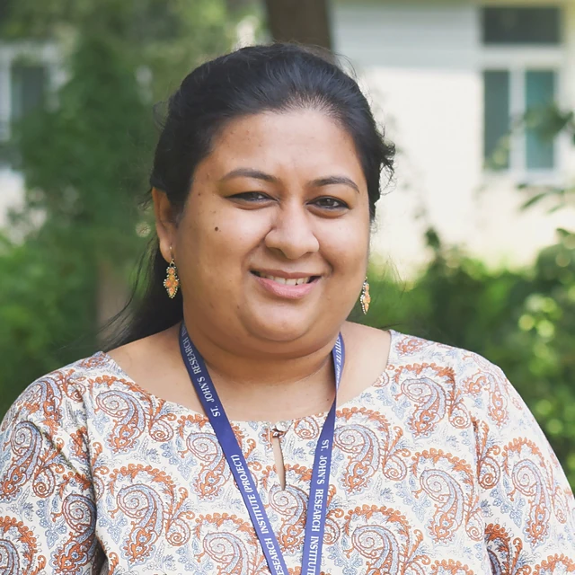</figure><div class="ptext"><span class="ptag">Group lead</span><h3>Chandni Halcyon Peris</h3><p class="prole">Project Coordinator</p><p class="pbio">Ph.D. scholar (MAHE). Over a decade in clinical nutrition and nutrition research at SJRI, from medical nutrition therapy to trials on vitamin D dose–response, fortified rice and iron. Coordinates the PGIMER–BMGF Vitamin A &amp; D Fortification Study.</p><p class="psup"><span>PhD supervisor</span> Prof. Prashanth Thankachan</p><p class="pbeyond"><span>Beyond work</span> Loves to travel, always has a book on the go, and enjoys music and dance.</p><details class="pmore"><summary>Profile and publications</summary><div class="pmore-body"><h4>Education</h4><ul><li>Ph.D. Nutrition (ongoing, since 2022) – MAHE, Manipal, with SJRI as research centre</li><li>M.Sc. Food Science and Nutrition, 2013 – Mount Carmel College</li><li>B.Sc. Nutrition, Dietetics, Chemistry and Zoology, 2011 – Mount Carmel College</li></ul><h4>Research interests</h4><p>Clinical and public health nutrition, micronutrient deficiencies, vitamin D metabolism and bone health, iron bioavailability, food fortification, stable isotope methods, dietary assessment and community-based trials.</p><h4>Awards</h4><ul><li>Mighty Nutrients Early Career Award, 6th Micronutrient Forum Global Conference, The Hague (2023)</li><li>NSI Prize for Best Oral Presentation, Clinical Nutrition, 55th NSI National Conference (2023)</li></ul><h4>Publications</h4><ul><li>Peris CH et al. The dose–response effects of vitamin D3 on serum 25-hydroxyvitamin D levels in vitamin D-deficient young Indian women: a randomized controlled trial. Nutrients, 2026;18(9):1476. <a href="https://doi.org/10.3390/nu18091476" target="_blank" rel="noopener">DOI</a></li><li>Peris CH et al. Associations of bone health biomarkers and bone mineral density with dietary intakes in vitamin D-deficient women. Scientific Reports, 2025;15:43213. <a href="https://doi.org/10.1038/s41598-025-27321-1" target="_blank" rel="noopener">DOI</a></li><li>Kuriyan R et al. Portion-controlled ready-to-eat meal replacement is associated with short-term weight loss: a randomized controlled trial. Asia Pacific Journal of Clinical Nutrition, 2017.</li><li>Peris CH, Singh K, D’Souza M. Nutritional and biochemical evaluation of Averrhoa bilimbi L. Archives of Pharmacy and Biological Sciences, 2013;1(2).</li></ul></div></details></div></article></div>
<div class="pgrid"><article id="chiranjeevi-k" class="pcard" tabindex="0"><figure class="pface v0">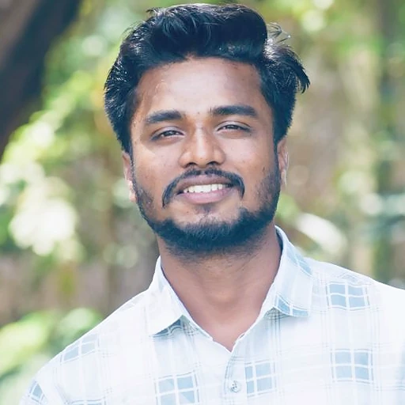</figure><div class="ptext"><h3>Chiranjeevi K</h3><p class="prole">Project Technical Support III</p><p class="pbio">B.Sc. MLT. Phlebotomy, biospecimen handling and tracking, and field coordination for the vitamin A and D project.</p><details class="pmore"><summary>Profile and publications</summary><div class="pmore-body"><h4>Education</h4><ul><li>B.Sc. Medical Laboratory Technology</li></ul><h4>Positions</h4><ul><li>ICMR–NIN Diet and Biomarker Survey (DABS), Phases I–IV, including Andaman and Nicobar Islands</li><li>ICMR–ROHCS, Bengaluru</li><li>Phlebotomist, Division of Nutrition, SJRI, 2026</li></ul><h4>Research interests</h4><p>Maternal and child nutrition, anaemia and iron metabolism, micronutrient deficiencies, biomarker analysis.</p></div></details></div></article><article id="rachaprolu-usha" class="pcard" tabindex="0"><figure class="pface v1">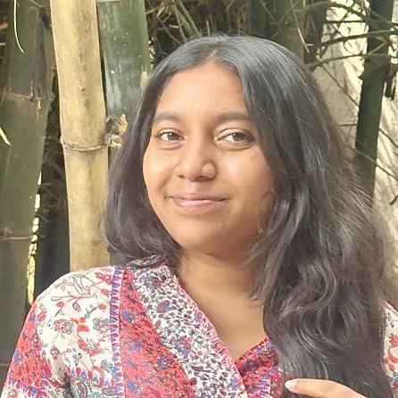</figure><div class="ptext"><h3>Rachaprolu Usha</h3><p class="prole">Field Staff · Data Entry</p><p class="pbio">Master’s in Hematology and Blood Transfusion. Phlebotomy, documentation and data collection for the vitamin A and D study.</p><details class="pmore"><summary>Profile and publications</summary><div class="pmore-body"><h4>Education</h4><ul><li>Master’s in Hematology and Blood Transfusion, 2025 – Bangalore Baptist Hospital</li><li>Bachelor’s in Medical Laboratory Technology, 2022 – Bangalore Baptist Hospital</li></ul><h4>Positions</h4><ul><li>Field staff and data entry, PGIMER–BMGF Vitamin A &amp; D study</li><li>Laboratory technician, Bangalore Baptist Hospital, 2022–2023</li></ul><h4>Research interests</h4><p>Haematology and blood transfusion studies; quality assurance, quality control and quality management in the laboratory. Hands-on with manual, semi-automated and fully automated analysers.</p></div></details></div></article><article id="vinod-p" class="pcard" tabindex="0"><figure class="pface v2">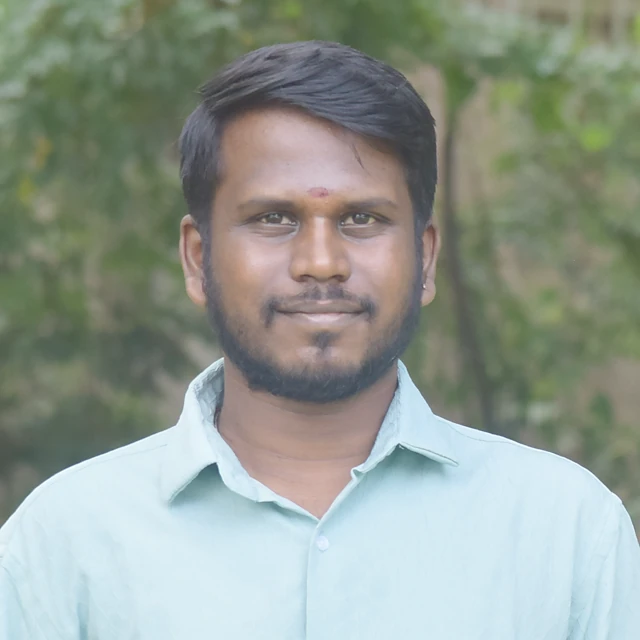</figure><div class="ptext"><h3>Vinod P</h3><p class="prole">Field Staff · Data Entry</p><p class="pbio">Collects participant data and enters it in REDCap for the vitamin A and D study; previously on ICMR projects at SJRI.</p><details class="pmore"><summary>Profile and publications</summary><div class="pmore-body"><h4>Education</h4><ul><li>Bachelor of Computer Applications</li></ul><h4>Positions</h4><ul><li>Field staff and data entry, PGIMER–BMGF Vitamin A &amp; D Project, SJRI</li><li>REDCap data entry, ICMR projects at SJRI, Oct 2024–Jul 2026</li></ul><h4>Research interests</h4><p>Accurate REDCap data entry and adherence to study protocols.</p></div></details></div></article><article id="suma-banakar" class="pcard" tabindex="0"><figure class="pface v3">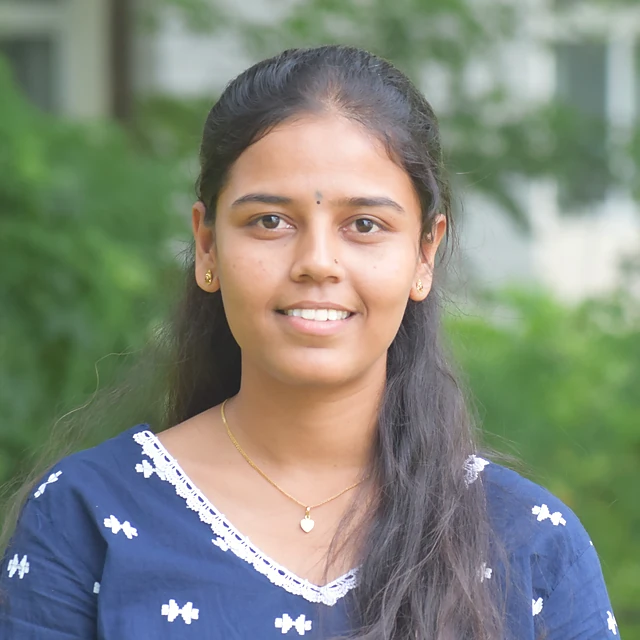</figure><div class="ptext"><h3>Suma Banakar</h3><p class="prole">Field Staff · Data Entry</p><p class="pbio">M.Sc. Food and Nutrition. Field activities, data collection and entry for the vitamin A and D fortification learning initiative.</p><details class="pmore"><summary>Profile and publications</summary><div class="pmore-body"><h4>Education</h4><ul><li>M.Sc. Food and Nutrition – Vasantrao Naik Marathwada Krishi Vidyapeeth, Parbhani</li><li>B.Sc. Community Science – University of Agricultural Sciences, Dharwad</li></ul><h4>Research interests</h4><p>Public health nutrition, micronutrient fortification and community-based nutrition interventions. Has published research papers from her M.Sc. thesis work.</p></div></details></div></article></div></section>
</section>
<section class="pgroup" id="g2"><header class="pgroup-head"><span class="eyebrow">02 · ICMR-CAR MEDTECH</span><h2>MedTech</h2><p>Clinical need to validated device. Design, fabrication and clinical validation of low-cost medical devices, from the Makers Lab and the Rehabilitation and Assistive Device Development Lab.</p></header>
<div class="plead-strip"><article id="clinton-wilson" class="pcard lead" tabindex="0"><figure class="pface v2">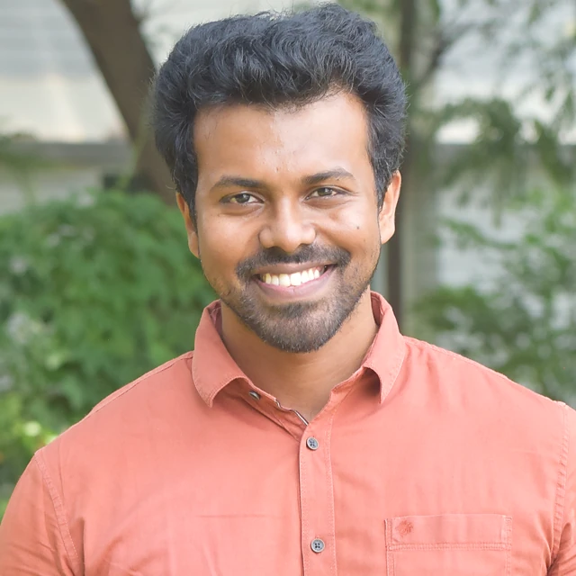</figure><div class="ptext"><span class="ptag">Group lead</span><h3>Clinton Wilson Barnabas V</h3><p class="prole">Project Research Scientist III (Non-Medical)</p><p class="pbio">Ph.D. in Biomechanics (VIT) with a background in mechanical engineering and design. Heads the Rehabilitation and Assistive Device Development Lab at St. John’s Hospital and leads staff and interns at the ICMR-CAR MEDTECH Makers Lab. His work runs from clinical needs and device design through study protocols, trials and validation, with a focus on low-cost rehabilitation and assistive devices.</p><p class="pbeyond"><span>Beyond work</span> Keeps fit at the gym and in the pool, plays guitar and lends his voice to the church choir.</p><details class="pmore"><summary>Profile and publications</summary><div class="pmore-body"><h4>Education</h4><ul><li>Ph.D. Biomechanics, 2026 – VIT, Vellore</li><li>MBA General Management, 2022 – Jain University</li><li>M.Tech. Engineering Design, 2020 – Karunya University</li><li>B.E. Mechanical Engineering, 2017 – Don Bosco Institute of Technology</li></ul><h4>Research interests</h4><p>Medical device design and development, rehabilitation and assistive technologies, clinical validation, 3D printing and additive manufacturing for medical use, biomechanics and human movement analysis, translational research and commercialisation.</p><h4>Patent applications (India)</h4><ul><li>Treadmill-based gait training device, 202341088409 (2024)</li><li>Lifting and transfer mechanism for gait training device, 202441078671 (2024)</li><li>Mobile, overground gait training device, 202541028968 (2025)</li><li>Leg support for gait rehabilitation, 202541040825 (2025)</li></ul><h4>Publications</h4><ul><li>Clinton Wilson BV, Mohan Varma DS. Cost-effective clinical methods to evaluate the efficacy of gait training devices: a systematic review of randomized controlled trials. Journal of Medical Devices, 2025;19:010801.</li><li>Clinton Wilson BV, Mohan Varma DS. Preliminary testing of a mechanism-based gait training device with able-bodied individuals. Journal of Enabling Technologies, 2025;19(1):1–14.</li><li>Ganesan G, Barnabas V, Ganesan AK. Optimal dimensional synthesis of one degree of freedom fixed cam-link four-bar mechanisms to generate filleted rectangular paths. Mechanics Based Design of Structures and Machines, 2023;51(10):5531–5540.</li><li>Ganesan G, Clinton Wilson BV, Rai SR. Dimensional synthesis of adjustable mechanism to generate square path. AIP Conference Proceedings, 2020;2270:040009.</li><li>Govindasamy G, Clinton Wilson BV, Neeraj K. Kinematic analysis and dimensional synthesis of filleted-rhombus path generating adjustable four-bar mechanism. Lecture Notes in Mechanical Engineering, Springer, 2020.</li></ul></div></details></div></article></div>
<div class="pgrid"><article id="sowmya-hr" class="pcard" tabindex="0"><figure class="pface v3">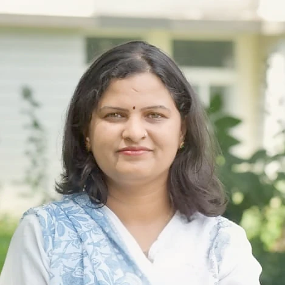</figure><div class="ptext"><h3>Sowmya H. R.</h3><p class="prole">Project Research Scientist II · Project Manager</p><p class="pbio">PhD student (MAHE) with sixteen years in mental health and behavioural research. Point of contact for project operations in ICMR-CAR MEDTECH, writing validation protocols and SOPs and coordinating studies with clinicians, IITs and device inventors.</p><p class="psup"><span>PhD supervisor</span> Dr. Susan Thomas, Associate Professor, Division of Mental Health and Neurosciences</p><p class="pbeyond"><span>Beyond work</span> Offers counselling and mental health support to her community, with music for the downtime.</p><details class="pmore"><summary>Profile and publications</summary><div class="pmore-body"><h4>Education</h4><ul><li>Ph.D. (ongoing) – MAHE, Manipal. Thesis: Problematic smartphone use among older adults in India, a mixed-methods study</li><li>M.Sc. Psychology, 2008 – Bangalore University</li></ul><h4>Positions</h4><ul><li>Project Research Scientist II, ICMR-CAR MEDTECH, SJRI, 2024–present</li><li>Research projects in Psychiatry, SJRI, 2019–2024</li><li>Senior Project Fellow, NIMHANS, 2009–2019</li></ul><h4>Research interests</h4><p>Mental health and behavioural sciences, behavioural (technology) addiction, community mental health, qualitative research, tool development, clinical research and validation.</p><h4>Award</h4><ul><li>1st place poster, 3rd Annual Research Day, SJRI (2021): Adaptation of the Kannada version of the Global Mental Health Assessment Tool</li></ul><h4>Publications</h4><ul><li>Chandra PS, Sowmya HR et al. ‘SMS’ for mental health: feasibility and acceptability of text messages for mental health promotion among young women from urban low-income settings in India. Asian J Psychiatry, 2014.</li><li>Sidheek KF, Satyanarayana VA, Sowmya HR, Chandra PS. Kannada version of the Connor-Davidson Resilience Scale among adolescent girls in Bangalore. Asian J Psychiatry, 2017.</li><li>Satyanarayana VA et al. Three sides of a triangle: gender disadvantage, resilience and psychological distress in adolescent girls from India. Int J Culture and Mental Health, 2016.</li><li>Sowmya HR et al. Cultural expression of anxiety symptoms in Kannada language: a qualitative study. Indian J Psychol Med, 2023.</li><li>Rao VS et al. Parent mediated interventions for children with autism across India: a qualitative study. J Indian Assoc Child Adolesc Mental Health, 2024.</li><li>Choudhury AR et al. Multimodal behavioral analysis of child play interactions for early detection of autism spectrum disorder. Infant Behavior and Development, 2026;84:102205.</li><li>Roy Choudhury A et al. VLM-guided toddler behavior recognition from semi-structured triadic play videos. Proc. 3rd Int. Workshop on Multimodal and Responsible Affective Computing, 2025.</li><li>Berlin SJ et al. Early diagnosis of autism through behaviors from semi-structured triadic play interaction videos. Proc. ICVGIP, 2025.</li></ul></div></details></div></article><article id="yogananth-sakthivel" class="pcard" tabindex="0"><figure class="pface v4"></figure><div class="ptext"><h3>Yogananth Sakthivel</h3><p class="prole">Project Technical Support III</p><p class="pbio">Runs clinical validation studies of medical devices and digital health innovations with hospitals, clinicians and MedTech start-ups. Has coordinated or monitored more than 20 clinical research projects, with protocol, ethics and regulatory documentation.</p><details class="pmore"><summary>Profile and publications</summary><div class="pmore-body"><h4>Education</h4><ul><li>M.Sc. Biotechnology, 2018 – Bharathiar University (Dr. G.R. Damodaran College)</li><li>B.Sc. Biotechnology, 2016 – Bharathiar University</li></ul><h4>Positions</h4><ul><li>Senior Research Associate (BIRAC-DBT), St. John’s, 2024–2025</li><li>Laboratory Coordinator (BIRAC-DBT), St. John’s, 2022–2023</li><li>Project Associate, CSIR-CECRI, 2020–2021 (biodegradable polymers for tissue engineering)</li></ul><h4>Research interests</h4><p>Clinical validation of medical devices and digital health technologies, rheumatology and immunology research (registries, trials, real-world evidence), nutrition and food fortification.</p><h4>Outputs</h4><ul><li>Abstracts at ACR Convergence 2025, EULAR 2024 and ISTH 2024</li><li>Co-author: Evaluation and prescription trends in systemic sclerosis: a report among Indian rheumatologists</li></ul></div></details></div></article><article id="soundarya-ts" class="pcard" tabindex="0"><figure class="pface v0">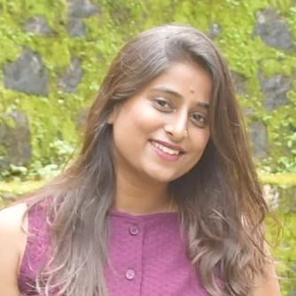</figure><div class="ptext"><h3>Soundarya T S</h3><p class="prole">Project Technical Support II</p><p class="pbio">M.Pharm in Pharmacology. Works on medical device research: patient recruitment, clinical data collection, study protocols and review papers.</p></div></article><article id="sneha-ann-shibu" class="pcard" tabindex="0"><figure class="pface v1">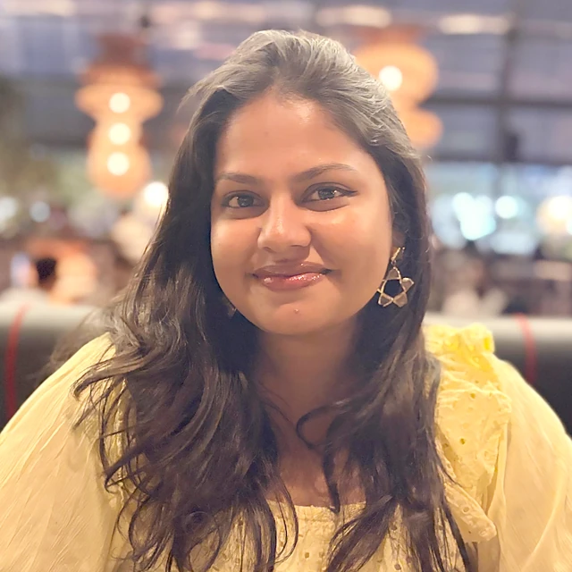</figure><div class="ptext"><h3>Sneha Ann Shibu</h3><p class="prole">Project Technical Support III</p><p class="pbio">Provides technical support to research projects, sets up project tools and writes protocols. Has two published review papers, on scrub typhus and on AI in entomology.</p><p class="pbeyond"><span>Beyond work</span> Sings, dances and plays badminton, and is happiest outdoors with family and friends.</p><details class="pmore"><summary>Profile and publications</summary><div class="pmore-body"><h4>Publications</h4><ul><li>A comprehensive review of scrub typhus: an emerging masquerade of fever, 2025.</li><li>Artificial intelligence (AI) in entomology: Indian scenario, 2024.</li></ul></div></details></div></article><article id="pavan-s" class="pcard" tabindex="0"><figure class="pface v2">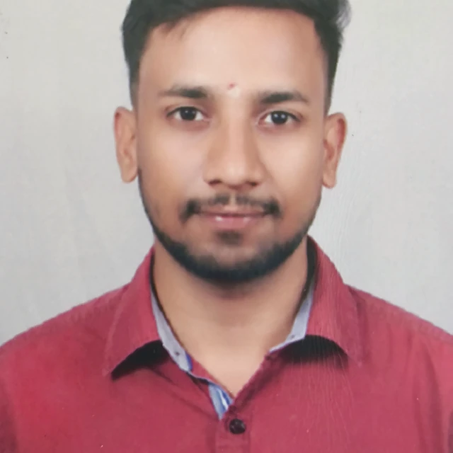</figure><div class="ptext"><h3>Pavan S</h3><p class="prole">Senior Project Assistant</p><p class="pbio">M.Tech in Machine Design (BMSCE). Supports laboratory equipment setup and maintenance, prototype work, progress reporting and project coordination.</p><p class="pbeyond"><span>Beyond work</span> Cricket on the field, films off it, and always picking up some new software.</p><details class="pmore"><summary>Profile and publications</summary><div class="pmore-body"><h4>Education</h4><ul><li>M.Tech. Machine Design, 2026 – B.M.S. College of Engineering</li><li>B.E. Mechanical Engineering, 2024 – Dayananda Sagar College of Engineering</li><li>Diploma in Mechanical Engineering, 2021 – P.E.S. Polytechnic</li></ul><h4>Positions</h4><ul><li>Senior Project Assistant, SJRI, 2026–present</li><li>Research Intern, ICMR-CAR MEDTECH, SJRI</li><li>MTech Intern, IDEA Lab, BMSCE, 2025–2026</li><li>Engineering Intern, Magellan Aerospace, 2024</li></ul><h4>Research interests</h4><p>Engineering design, medical technology, laboratory instrumentation, prototype development and applying engineering to research problems.</p></div></details></div></article><article id="hadlee" class="pcard" tabindex="0"><figure class="pface v3"></figure><div class="ptext"><h3>Hadlee</h3><p class="prole">Data Entry Operator</p><p class="pbio">Manages data across several projects and runs the quality checks that keep it accurate and consistent. Also a professional cricketer and athlete.</p><p class="pbeyond"><span>Beyond work</span> A professional cricketer and athlete when he is away from the data desk.</p></div></article><article id="sisira-m" class="pcard" tabindex="0"><figure class="pface v4">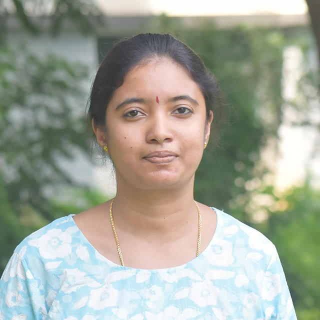</figure><div class="ptext"><h3>Sisira M</h3><p class="prole">Data Entry Operator</p><p class="pbio">Six years in healthcare data management and clinical research support. Handles data entry, quality checks and documentation for research teams. B.Sc. Biotechnology.</p></div></article></div></section>
<section class="pgroup" id="g3"><header class="pgroup-head"><span class="eyebrow">03 · Data · AI</span><h2>Computational Science and Data Systems</h2><p>Machine learning, clinical AI validation and the data systems behind the centre’s studies.</p></header>
<div class="plead-strip"><article id="ashwin-mohan" class="pcard lead" tabindex="0"><figure class="pface v0">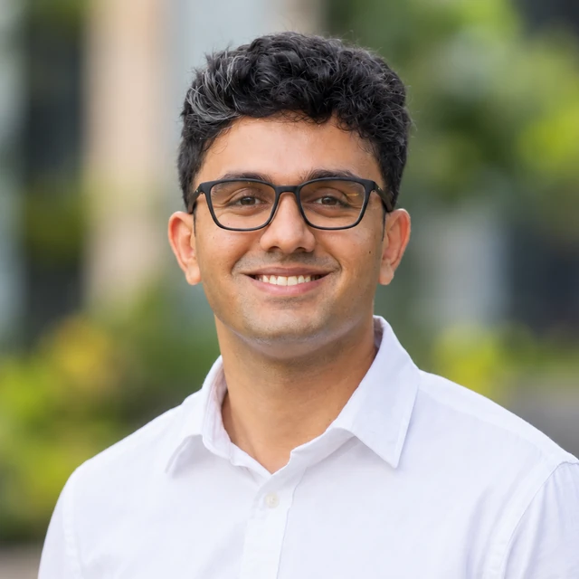</figure><div class="ptext"><span class="ptag">Group lead</span><h3>Ashwin Mohan</h3><p class="prole">Project Research Scientist II</p><p class="pbio">AI/ML research scientist working in clinical and digital health settings. Leads the Computational Science and Data Systems group, with work on clinical AI validation, uncertainty-aware modelling and deployment of digital health systems in resource-limited settings, including the PRAKASH anaemia surveillance platform. MSc Diagnostics, Data and Digital Health (Warwick); B.Tech Applied Electronics and Instrumentation (Calicut).</p><p class="pbeyond"><span>Beyond work</span> Marathon runner, avid reader and caricature artist in his free time, with a connoisseur’s eye for design.</p><details class="pmore"><summary>Profile and publications</summary><div class="pmore-body"><h4>Education</h4><ul><li>MSc Diagnostics, Data and Digital Health – University of Warwick</li><li>B.Tech. Applied Electronics and Instrumentation Engineering – University of Calicut</li></ul><h4>Positions</h4><ul><li>Project Research Scientist II, ICMR-CAR MEDTECH, SJRI</li></ul><h4>Research interests</h4><p>Clinical AI validation, uncertainty-aware modelling (Bayesian frameworks, causal inference), medical imaging, and deployment of digital health systems in resource-limited settings. Background in embedded electronics and hardware.</p><h4>MSc thesis</h4><ul><li>Automated deep-learning segmentation pipeline for forearm X-ray bone mineral density estimation, using a multi-centre dataset from three institutions and two continents</li></ul><h4>Website</h4><p><a href="https://ashmohang.github.io" target="_blank" rel="noopener">ashmohang.github.io</a></p><h4>Publications</h4><ul><li>Adaptive speaker recognition using Gaussian mixture models and vector quantization. Computers and Electrical Engineering (Elsevier), 2016.</li><li>Systematic review and meta-analysis of rice, wheat and salt fortification and anaemia, micronutrient and iodine status in India. First author; PROSPERO CRD420261306419; in progress.</li></ul></div></details></div></article></div>
<div class="pgrid"><article id="adwin-thomas-c" class="pcard" tabindex="0"><figure class="pface v1">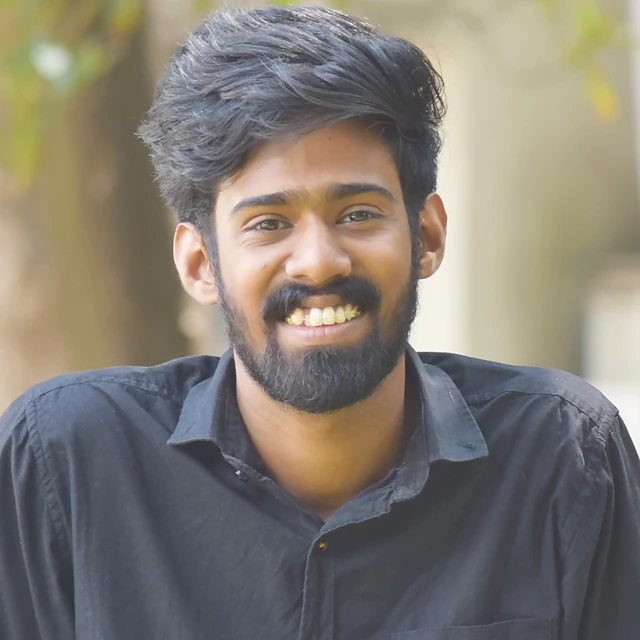</figure><div class="ptext"><h3>Adwin Thomas C</h3><p class="prole">Data Scientist</p><p class="pbio">Builds intelligent, data-driven solutions to real-world problems in healthcare and AI, turning complex data into insight through machine learning, computer vision and digital health systems. Works on clinical data pipelines, real-time monitoring dashboards and visual SLAM.</p><p class="pbeyond"><span>Beyond work</span> A singer at heart who also loves tinkering with new technology.</p><details class="pmore"><summary>Profile and projects<a class="pin" href="https://www.linkedin.com/in/adwinthomasc/" target="_blank" rel="noopener" aria-label="Adwin Thomas C on LinkedIn" title="LinkedIn"><svg viewBox="0 0 24 24" aria-hidden="true"><path fill="currentColor" d="M20.45 20.45h-3.56v-5.57c0-1.33-.03-3.04-1.85-3.04-1.85 0-2.14 1.45-2.14 2.94v5.67H9.35V9h3.41v1.56h.05c.48-.9 1.64-1.85 3.37-1.85 3.6 0 4.27 2.37 4.27 5.45v6.29zM5.34 7.43a2.06 2.06 0 1 1 0-4.12 2.06 2.06 0 0 1 0 4.12zM7.12 20.45H3.56V9h3.56v11.45zM22.22 0H1.77C.79 0 0 .77 0 1.73v20.54C0 23.23.79 24 1.77 24h20.45c.98 0 1.78-.77 1.78-1.73V1.73C24 .77 23.2 0 22.22 0z"/></svg></a></summary><div class="pmore-body"><h4>Education</h4><ul><li>M.Sc. Data Science – Christ University, Bengaluru (2025)</li><li>B.Voc. Data Science – St. Thomas College (Autonomous), Thrissur (2023)</li></ul><h4>Experience</h4><p>Data scientist at St. John’s Research Institute, Bengaluru, on healthcare research programmes and digital health initiatives. Develops clinical data pipelines, AI-supported healthcare workflows and real-time monitoring dashboards for public health programmes, including digital systems for anaemia screening and follow-up, hospital operations monitoring and clinical data management. Current work includes visual simultaneous localisation and mapping (VSLAM).</p><h4>Areas of interest</h4><ul><li>Artificial intelligence and machine learning</li><li>Healthcare data science and clinical analytics</li><li>Computer vision and medical imaging</li><li>Visual SLAM</li><li>Statistical analysis and signal processing</li><li>Digital health systems and decision-support tools</li><li>Data visualisation and real-time monitoring systems</li></ul><h4>Technical expertise</h4><ul><li><strong>Programming:</strong> Python, SQL, R</li><li><strong>Data science:</strong> data cleaning, exploratory data analysis, statistical analysis, feature engineering</li><li><strong>Machine learning:</strong> supervised learning, classification, model evaluation and validation</li><li><strong>Computer vision:</strong> medical image analysis, object detection, VSLAM</li><li><strong>Visualisation:</strong> Plotly Dash, Power BI, Microsoft Excel</li><li><strong>Databases:</strong> MySQL and relational data management</li><li><strong>Tools:</strong> Git, GitHub, Jupyter Notebook, TensorFlow, Visual Studio Code</li></ul><h4>Links</h4><p><a href="https://adwinthomasc.github.io/portfolio/" target="_blank" rel="noopener">Portfolio</a> · <a href="https://github.com/AdwinThomasC" target="_blank" rel="noopener">GitHub</a></p></div></details></div></article><article id="athul-s-kumar" class="pcard" tabindex="0"><figure class="pface v2">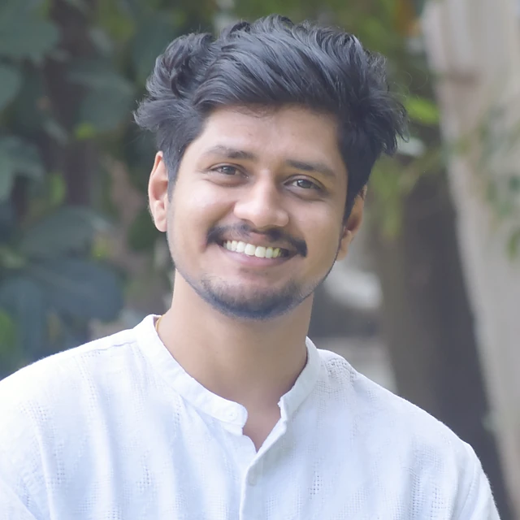</figure><div class="ptext"><h3>Athul S Kumar</h3><p class="prole">Data Scientist</p><p class="pbio">Builds AI systems that can reason and support real decisions, turning complex health data into practical, intelligent tools. Works on medical imaging, markerless gait analysis and SLAM.</p><p class="pbeyond"><span>Beyond work</span> A motor enthusiast through and through.</p><details class="pmore"><summary>Profile and projects<a class="pin" href="https://www.linkedin.com/in/athulskumar010/" target="_blank" rel="noopener" aria-label="Athul S Kumar on LinkedIn" title="LinkedIn"><svg viewBox="0 0 24 24" aria-hidden="true"><path fill="currentColor" d="M20.45 20.45h-3.56v-5.57c0-1.33-.03-3.04-1.85-3.04-1.85 0-2.14 1.45-2.14 2.94v5.67H9.35V9h3.41v1.56h.05c.48-.9 1.64-1.85 3.37-1.85 3.6 0 4.27 2.37 4.27 5.45v6.29zM5.34 7.43a2.06 2.06 0 1 1 0-4.12 2.06 2.06 0 0 1 0 4.12zM7.12 20.45H3.56V9h3.56v11.45zM22.22 0H1.77C.79 0 0 .77 0 1.73v20.54C0 23.23.79 24 1.77 24h20.45c.98 0 1.78-.77 1.78-1.73V1.73C24 .77 23.2 0 22.22 0z"/></svg></a></summary><div class="pmore-body"><h4>Education</h4><ul><li>MSc Data Science – Christ University, Bengaluru (2025)</li><li>Bachelor of Computer Applications in Data Science – Amrita Vishwa Vidyapeetham (2023)</li></ul><h4>Experience</h4><p>Data scientist at St. John’s Research Institute, Bengaluru, working on national healthcare research programmes under the Indian Council of Medical Research (ICMR). Designed and deployed a real-time monitoring dashboard for a multi-site national programme, and works closely with clinicians and domain experts to turn research questions into deployable tools.</p><h4>Areas of interest</h4><ul><li>AI systems that can reason and support clinical decision-making</li><li>Medical imaging and computer vision for healthcare</li><li>Biomedical knowledge graphs and hypothesis generation</li><li>Quantum machine learning</li><li>Markerless gait analysis, SLAM and robotics</li><li>Sensor and signal analytics for health monitoring</li></ul><h4>Technical expertise</h4><ul><li><strong>Programming:</strong> Python, R, SQL</li><li><strong>Machine learning:</strong> supervised learning, Random Forest, CNN, QCNN, feature engineering, model evaluation and validation</li><li><strong>Computer vision and robotics:</strong> medical image analysis (CT, X-ray), markerless gait analysis, SLAM</li><li><strong>Statistics:</strong> exploratory data analysis, hypothesis testing, longitudinal analysis, FFT-based signal processing</li><li><strong>Visualisation:</strong> Dash, Tableau, Power BI, Matplotlib, Seaborn</li><li><strong>Tools:</strong> TensorFlow, TensorFlow Quantum, Streamlit, Graph</li></ul><h4>Selected projects</h4><ul><li>Hybrid Quantum Convolutional Neural Network built with TensorFlow Quantum for skin cancer classification, reaching competitive accuracy with fewer parameters than CNN and QNN baselines.</li><li>Biomedical knowledge graph built from NCBI datasets to reveal latent gene–disease–treatment associations and support hypothesis generation.</li></ul><h4>Links</h4><p><a href="https://athuls010.github.io/portfolio/" target="_blank" rel="noopener">Portfolio</a></p></div></details></div></article></div></section>
<section class="pgroup" id="g6"><header class="pgroup-head"><span class="eyebrow">04 · Collaborators</span><h2>Collaborators</h2><p>Faculty colleagues who work closely with the group.</p></header><div class="pgrid"><article id="sumati" class="pcard" tabindex="0"><figure class="pface v4">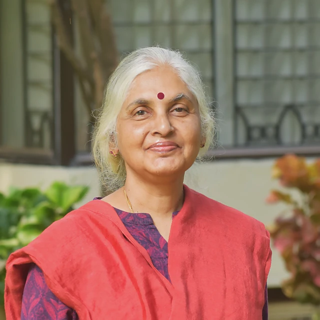</figure><div class="ptext"><h3>Dr. Sumathi Swaminathan</h3><p class="prole">Associate Professor, Division of Nutrition</p><p class="pbio">Experienced nutritionist with over three decades of work in nutritional research, teaching and community-based studies. Her work addresses the triple burden of malnutrition and chronic diseases through innovative, evidence-based approaches. Director of the start-up Nutrishakthi Private Limited.</p></div></article><article id="sumithra" class="pcard" tabindex="0"><figure class="pface v0">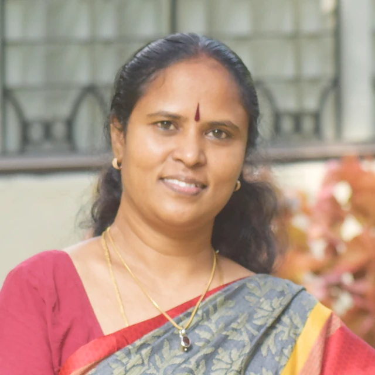</figure><div class="ptext"><h3>Dr. Sumithra S</h3><p class="prole">Associate Professor, Division of Epidemiology, Biostatistics and Population Health</p><p class="pbio">Biostatistician for the PRAKASH and ICMR-CAR MEDTECH programmes.</p></div></article></div></section>
</div>
<script>document.querySelectorAll(".pcard").forEach(function(c){c.addEventListener("click",function(e){if(e.target.closest("details")||!window.matchMedia("(hover: none)").matches)return;c.classList.toggle("is-color")});c.addEventListener("keydown",function(e){if(e.target.closest("summary"))return;if(e.key==="Enter"||e.key===" "){e.preventDefault();c.classList.toggle("is-color")}})});</script>
```
