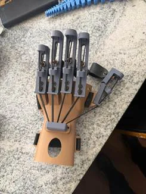
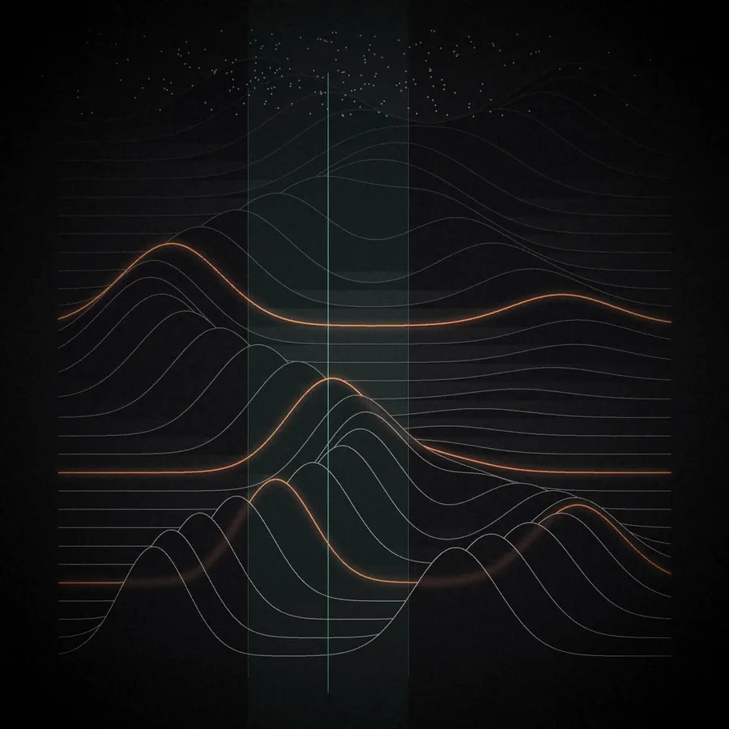
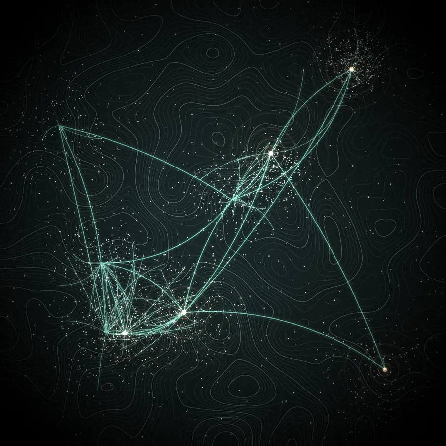

Six themes, running from nutrition trials in the field to devices and software built inside the hospital.

```{=html}
<div class="themes">
<div class="theme "><div class="theme-img"><figure class="pebble s-pebble-a  glows" style="--ar:1.0;--ang:120deg;--glow:255,170,30;--blend:screen;--gx:86%;--gy:71%"></figure></div><div class="theme-text"><span class="p-num">01</span><h3>Micronutrient deficiencies and public health</h3><p>The group has run food fortification trials with rice, wheat flour, atta, extruded foods and fortified drinks, and works on anaemia, micronutrient deficiency and nutritional evaluation in children and young women. Stable isotope methods are used to measure how much of a nutrient the body absorbs and how nutrients interact in food.</p><p>A main focus is getting micronutrient formulations right inside a food, so that absorption improves. The group works with national and international institutions and with food industry on products that raise micronutrient status and show a real physiological effect.</p></div></div><div class="theme-break"></div><div class="theme flip"><div class="theme-img"><figure class="pebble s-lens  glows" style="--ar:1.15;--ang:150deg;--glow:60,255,160;--blend:soft-light;--gx:71%;--gy:86%"></figure></div><div class="theme-text"><span class="p-num">02</span><h3>Development and validation of medical devices</h3><p>CAR MEDTECH sits inside St John&#x27;s Hospital and Research Institute, so design, prototyping and testing happen with clinicians and patients. Hardware and software are changed over repeated rounds.</p><p>The data from these studies is meant to help device makers and industry through regulatory approval faster, and to bring down healthcare costs in India.</p></div></div><div class="theme-break"></div><div class="theme "><div class="theme-img"><figure class="pebble s-pebble-c  glows" style="--ar:1.0;--ang:200deg;--glow:70,255,170;--blend:screen;--gx:36%;--gy:89%"></figure></div><div class="theme-text"><span class="p-num">03</span><h3>Bayesian and uncertainty-aware modelling in public health systems</h3><p>Models that say how sure they are. In the toddler activity classifier, disagreement between 12 models is used as the uncertainty signal. In PRAKASH, haemoglobin readings are classified against WHO thresholds and low results are retested before action.</p></div></div><div class="theme-break"></div><div class="theme flip"><div class="theme-img"><figure class="pebble s-lens-r  glows" style="--ar:1.15;--ang:60deg;--glow:40,225,255;--blend:screen;--gx:86%;--gy:29%"></figure></div><div class="theme-text"><span class="p-num">04</span><h3>AI and machine learning for healthcare and precision medicine</h3><p>Clinical validation of AI tools in real settings, including the LIRA screening software, and in-house tools such as smartphone gait analysis, built as an alternative to OpenCap.</p></div></div><div class="theme-break"></div><div class="theme "><div class="theme-img"><figure class="pebble s-pebble-b  glows" style="--ar:1.0;--ang:140deg;--glow:255,176,32;--blend:screen;--gx:77%;--gy:82%"></figure></div><div class="theme-text"><span class="p-num">05</span><h3>Signal, imaging and sensor analytics</h3><p>Accelerometer activity classification from raw 80 Hz data, wearable and Wi-Fi temperature sensing, camera-based gait analysis and visual SLAM.</p></div></div><div class="theme-break"></div><div class="theme flip"><div class="theme-img"><figure class="pebble s-lens  glows" style="--ar:1.2;--ang:110deg;--glow:90,255,150;--blend:screen;--gx:89%;--gy:64%"></figure></div><div class="theme-text"><span class="p-num">06</span><h3>Hospital and embedded systems</h3><p>Bed monitoring and operation theatre management software for St John&#x27;s Medical College Hospital, ESP32-based sensing, and a planned digital key management system.</p></div></div>
</div>
```

## Where the work is funded and published

See [Grants](../grants/index.qmd) for the funded projects and [Publications](../publications/index.qmd) for papers. Devices, software and each group's work are on the [Groups](../groups/index.qmd) pages.
